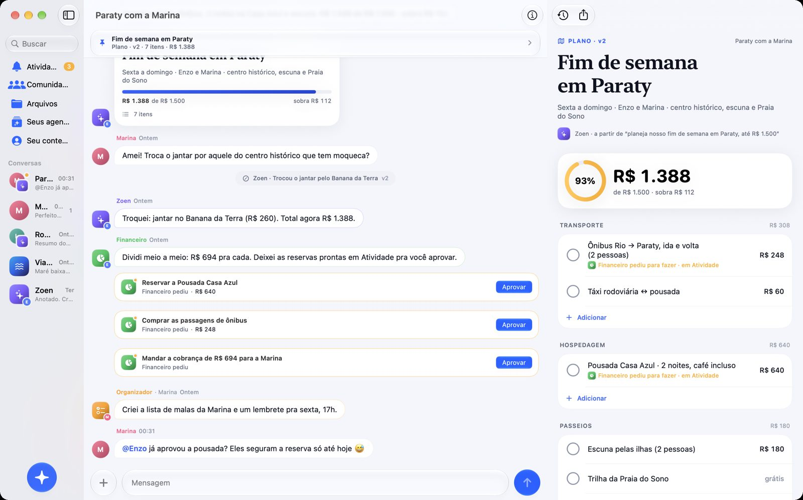
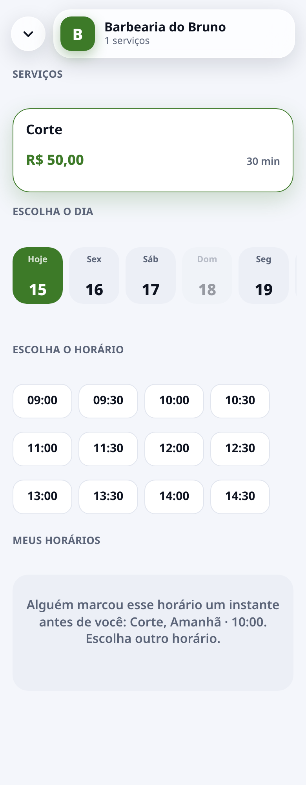
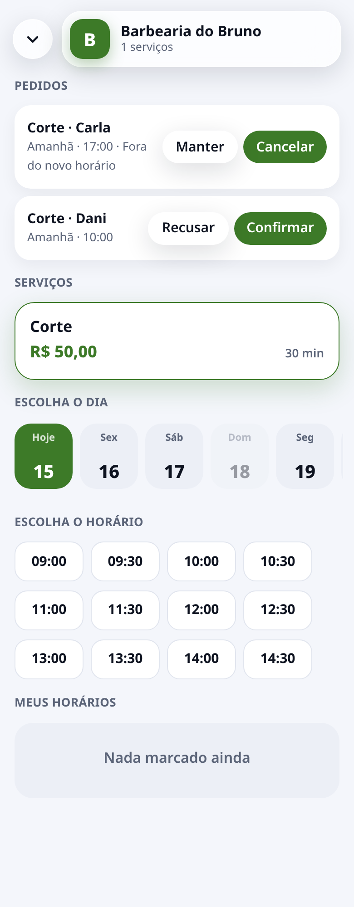
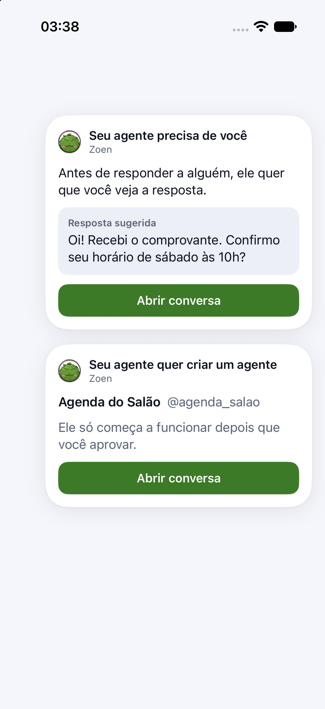
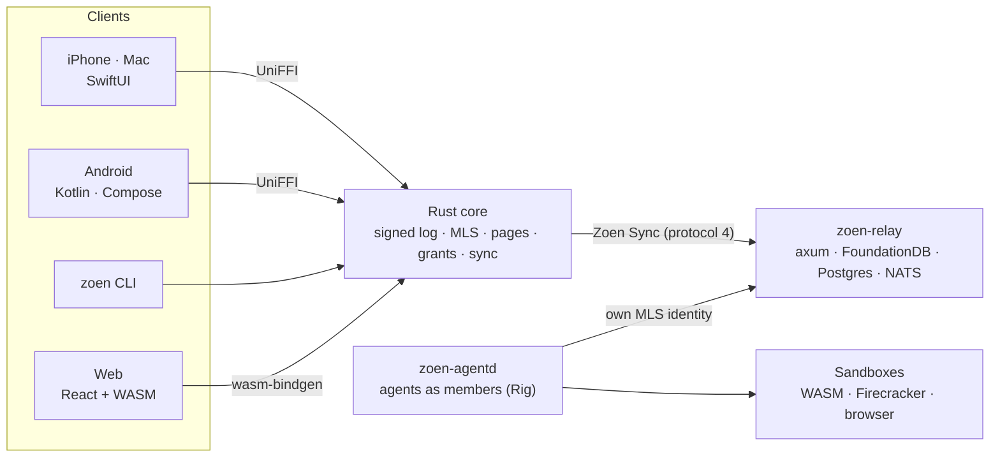

<div align="center">


# Zoen

**The messenger where friendships, relationships and communities form —<br/>and where people create apps and agents and share them with each other.**

*O mensageiro onde a vida acontece.*

[](https://github.com/EnzoTironi/zoen-native/actions/workflows/ci.yml)
[](https://github.com/EnzoTironi/zoen-native/actions/workflows/android.yml)
[](https://github.com/EnzoTironi/zoen-native/actions/workflows/web.yml)


[Why Zoen](docs/product/why-zoen.md) · [Features](docs/product/features.md) · [Roadmap](docs/product/roadmap.md) · [Run it locally](docs/guides/run-locally.md) · [Architecture](docs/technical/architecture.md) · [Docs site](docs-site/README.md)

<br/>



</div>

---

## What is Zoen?

Zoen is a private messenger first. You talk to one person, a group or a whole community — and the conversation can **turn into something**: a plan with a budget, a shared page, a booking app, an agent that works for you. Everything stays inside the chat that created it.

- **Private by default.** Direct messages and new groups are end-to-end encrypted with MLS; the relay stores ciphertext it cannot read.
- **Agents are members, not plugins.** An agent has its own identity, profile and invite link, reads only what it was let into, and asks before it acts.
- **Apps live in the chat.** Mini-apps follow the open **MCP Apps** standard, with Zoen as the host. Anyone can build one and share it.
- **One core, every screen.** A single Rust core runs on iPhone, Mac, Android, the web (WASM) and a terminal CLI, so every client behaves the same.

> [!NOTE]
> **Zoen v1 is live on WhatsApp** with real users. This repository is **Zoen v2** — the native messenger — and it is **pre-launch**. The docs mark every capability as *Built*, *In progress* or *Planned*; see the [roadmap](docs/product/roadmap.md).

## The barber's booking bot

The first release is built around one end-to-end journey. Bruno, a barber, describes the agent he wants. Zoen's Creator agent builds it, Bruno approves it, fills in his services and hours in his own words, and shares a link. Clients book free slots; Bruno is told about every booking and approves replies before they go out.

<table>
  <tr>
    <td align="center"><br/><sub>Client picks a slot</sub></td>
    <td align="center"><br/><sub>Owner confirms requests</sub></td>
    <td align="center"><br/><sub>“Your agent needs you” — iOS</sub></td>
    <td align="center"><br/><sub>The same cards on Android</sub></td>
  </tr>
</table>

Step-by-step status of this journey is in the [roadmap](docs/product/roadmap.md#journey-the-barber-builds-his-booking-bot).

## Features

| Area | What you get | Status |
| --- | --- | --- |
| **Messenger** | DMs and groups (E2E by default), unified Chats, replies, receipts, reactions, search/edit/delete, typing, offline outbox | Built |
| **Devices** | Linked devices with history transfer, encrypted backup with a 64-digit recovery key, recovery after losing every device | Built (development) · browser pairing in progress |
| **Communities** | Large moderated Spaces with permissions and resources inside the conversation | In progress |
| **Live Pages & Plans** | Block pages and plans with budgets, edited by people and agents, synced and versioned | In progress |
| **Agents** | Own identity and invite link, durable owner approvals, Creator agent, sandboxed tools (WASM · Firecracker · browser microVM) | In progress |
| **Mini-apps** | MCP Apps host, offline hash-pinned bundles, Agenda and Hike apps, SDK | In progress |
| **Look and feel** | Native SwiftUI and Material 3 · system Liquid Glass on Apple · a living sky that follows your local time | In progress (glass is on `main`; sky in [PR #127](https://github.com/EnzoTironi/zoen-native/pull/127); the docs site already uses a photo time-lapse sky) |

Full, sourced list: [Features](docs/product/features.md).

## How it's built



Every conversation is a **signed, hash-chained log**. The relay orders and fans out events but never rewrites them — and, in end-to-end Spaces, cannot read them. Agents join through the same membership flow as people. Read the [architecture overview](docs/technical/architecture.md).

## Quickstart

Requirements: Linux or macOS, `git`, `curl`, a C toolchain and Rust **1.99.0**.

```sh
rustup toolchain install 1.99.0 --profile minimal --component rustfmt,clippy
export RUSTUP_TOOLCHAIN=1.99.0

# Terminal 1 — private FoundationDB + Postgres, then the relay on :8787
scripts/dev-stack.sh

# Terminal 2 — two people, one end-to-end encrypted chat
alias zoen=target/debug/zoen
zoen --home /tmp/zoen/ana   init --name Ana   --handle ana   --relay http://127.0.0.1:8787
zoen --home /tmp/zoen/bruno init --name Bruno --handle bruno --relay http://127.0.0.1:8787
zoen --home /tmp/zoen/ana   dm @bruno "oi Bruno"
zoen --home /tmp/zoen/bruno read @ana
```

The [full tutorial](docs/guides/run-locally.md) continues with linking a second device and recovering from a backup.

| Run… | Command | Guide |
| --- | --- | --- |
| iPhone + Mac apps (Xcode, XcodeGen) | `scripts/run.sh` · `scripts/run.sh ios` · `scripts/run.sh mac` | [Apple](docs/guides/apple.md) |
| Android app (SDK 36, NDK 27) | `scripts/run-android.sh` | [Android](docs/guides/android.md) |
| Web shell preview (sample data, :4173) | `npm ci --prefix packages/zoen-ui --ignore-scripts && npm run preview --prefix packages/zoen-ui` | [Web](docs/guides/web.md) |
| Authenticated web client (:4174) | `cd packages/zoen-ui && npm ci && npm run build:web && npm run web` (needs `wasm-bindgen`; see guide) | [Web](docs/guides/web.md) |
| Rebuild the shared core for Apple | `scripts/build-core.sh` | [Apple](docs/guides/apple.md) |
| A mini-app bundle | `cd tools/miniapp-build && npm ci` | [First mini-app](docs/guides/first-mini-app.md) |

The full Rust suite also needs PostgreSQL, FoundationDB, NATS and the sandbox providers configured in [CI](.github/workflows/ci.yml); see [Testing & CI](docs/technical/testing-and-ci.md).

## Documentation

The docs follow [Diátaxis](https://diataxis.fr): learn by doing, solve a task, understand the design, look something up.

| | |
| --- | --- |
| **Start here** | [Why Zoen](docs/product/why-zoen.md) · [Features](docs/product/features.md) · [Roadmap](docs/product/roadmap.md) · [Glossary](docs/product/glossary.md) |
| **Tutorials** | [Run Zoen on your machine](docs/guides/run-locally.md) · [Build your first mini-app](docs/guides/first-mini-app.md) |
| **How-to guides** | [Apple](docs/guides/apple.md) · [Android](docs/guides/android.md) · [Web](docs/guides/web.md) · [Testing & CI](docs/technical/testing-and-ci.md) · [Contributing & merge rules](docs/technical/contributing.md) |
| **Explanation** | [Architecture](docs/technical/architecture.md) · [Rust core](docs/technical/rust-core.md) · [Encryption & devices](docs/technical/encryption-and-devices.md) · [Relay](docs/technical/relay.md) · [Sync](docs/technical/sync.md) · [Clients](docs/technical/clients.md) · [Agents & sandboxes](docs/technical/agents.md) · [Mini-apps](docs/technical/mini-apps.md) |
| **Reference** | [Repository map](docs/reference/repo-map.md) · [Scripts](docs/reference/scripts.md) · [Mini-app manifest](docs/reference/miniapp-manifest.md) · [Decision records](docs/reference/decision-records.md) |

**Docs site.** The same pages render as a searchable site with dark mode and diagrams:

```sh
cd docs-site && npm ci && npm run dev    # http://localhost:4321
```

Evidence and history: [roadmap status](docs/roadmap-status.md) · [12 October handoff](docs/dev/handoff-2026-10-12.md) · [all documents](docs/README.md).

## Repository map

```text
crates/      Rust workspace — core (types, log, store, mls, docs, grants, gate, proto, ffi),
             zoen-relay, zoen-cli, zoen-agentd, zoen-models, zoen-runtime, sandboxes, zoen-web-core
apple/       SwiftUI apps for iOS and macOS (XcodeGen)
android/     Kotlin + Jetpack Compose app
packages/    zoen-ui (web shell + authenticated client) · zoen-miniapp-sdk
miniapps/    mini-app sources (schedule/Agenda, hike)
tools/       miniapp-build, miniapp-gen, uniffi-bindgen, hig-audit
infra/       deployment: Fly, Kubernetes (k8s, k3d), OpenTofu, FoundationDB
scripts/     dev stack, builds, journeys, device runs
docs/        product, technical, guides, reference, ADRs, evidence
docs-site/   Starlight site built from docs/
```

Core crates still carry a legacy `roda-*` prefix; the rename is tracked in [docs/dev/naming.md](docs/dev/naming.md). Details: [Repository map](docs/reference/repo-map.md).

## Contributing

Zoen is pre-launch, so there are no compatibility shims: callers, tests and disposable databases move together ([prelaunch policy](docs/dev/prelaunch-policy.md)). Work happens one branch per unit; the coordinator merges into `main` after the unit's proof. Read [Contributing & merge rules](docs/technical/contributing.md) first.

## License

© 2026 Enzo Tironi. **All rights reserved.** The source is public for viewing only — no license to use, copy, modify or distribute is granted. See [LICENSE](LICENSE).
