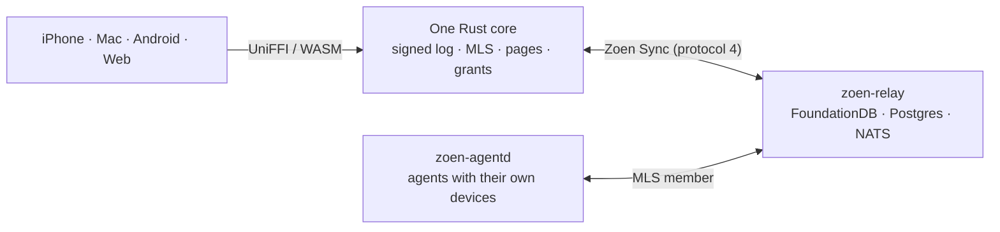

import { Card, CardGrid, LinkCard, Aside } from '@astrojs/starlight/components';

<Aside type="note" title="Where things stand">
Zoen **v1 is live on WhatsApp** with real users. This repository is **Zoen v2** — the native messenger — and it is **pre-launch**. Every page marks what is built, in progress or planned; the [roadmap](/product/roadmap/) has the details.
</Aside>

## What Zoen does

<CardGrid>
  <Card title="A private messenger" icon="comment">
    Direct chats, groups and communities in one **Chats** list. End-to-end encrypted by default with MLS; offline-first; linked devices with history.
  </Card>
  <Card title="Live Pages and Plans" icon="document">
    Documents the chat edits together — plans with budgets in exact cents, versions you can restore, all signed and synced.
  </Card>
  <Card title="Agents as members" icon="star">
    Agents have their own identity, profile and invite link. They read only where they're members and **ask before acting**.
  </Card>
  <Card title="Mini-apps" icon="puzzle">
    Small apps inside the chat on the open **MCP Apps** standard — booking, polls, lists, games — with state everyone sees live.
  </Card>
</CardGrid>

## The app on iPhone

  <figure><figcaption>Chats</figcaption></figure>
  <figure><figcaption>A group chat</figcaption></figure>
  <figure><figcaption>A community</figcaption></figure>
  <figure><figcaption>Writing a message</figcaption></figure>
  <figure><figcaption>Settings</figcaption></figure>
  <figure><figcaption>Getting started</figcaption></figure>

## The barber's booking bot

Bruno, a barber, describes the agent he wants. Zoen's Creator agent builds it, Bruno approves it, sets his services and hours in his own words, and shares a link. Clients book free slots; Bruno is told about every booking and approves replies before they go out.

  <figure><figcaption>“Your agent needs you”</figcaption></figure>
  <figure><figcaption>The same cards in dark mode</figcaption></figure>

[Follow the whole journey →](/product/roadmap/#journey-the-barber-builds-his-booking-bot)

## How it's built

One Rust core powers every client, so behaviour is identical everywhere. The relay orders and delivers events it usually can't read. Agents join chats as real, accountable members. [Read the architecture →](/technical/architecture/)

## Find your way

<CardGrid>
  <LinkCard title="Tutorials" description="Run the whole stack and talk end-to-end from two terminals. Build a mini-app." href="/guides/run-locally/" />
  <LinkCard title="How-to guides" description="Run the Apple, Android and web clients. Test and contribute." href="/guides/apple/" />
  <LinkCard title="Explanation" description="Architecture, the Rust core, encryption, relay, sync, agents, mini-apps." href="/technical/architecture/" />
  <LinkCard title="Reference" description="Repository map, scripts, the mini-app manifest, decision records, glossary." href="/reference/repo-map/" />
</CardGrid>

© 2026 Enzo Tironi. All rights reserved. The source is public for viewing only — see the <a href="https://github.com/EnzoTironi/zoen-native/blob/main/LICENSE">license</a>. Sky footage: U.S. National Park Service (public domain) and FreeSwissVideo (CC BY 3.0) — <a href="/credits/">credits</a>.

