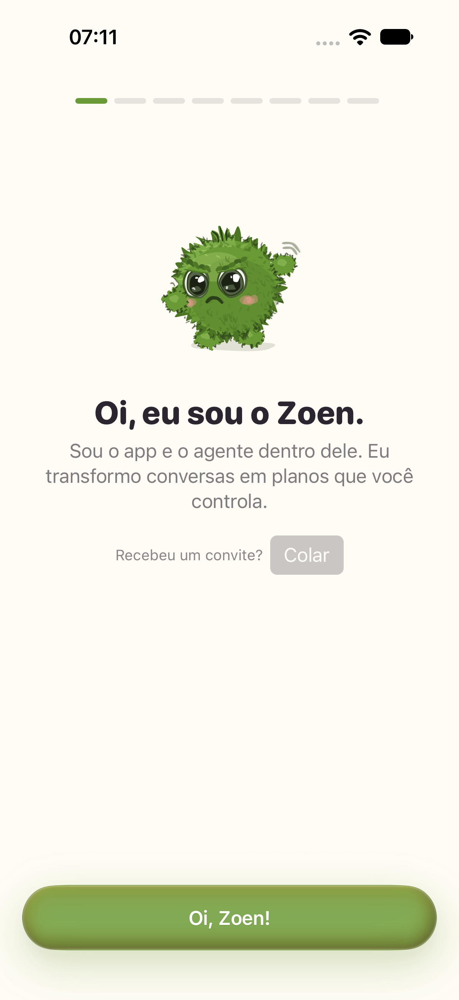
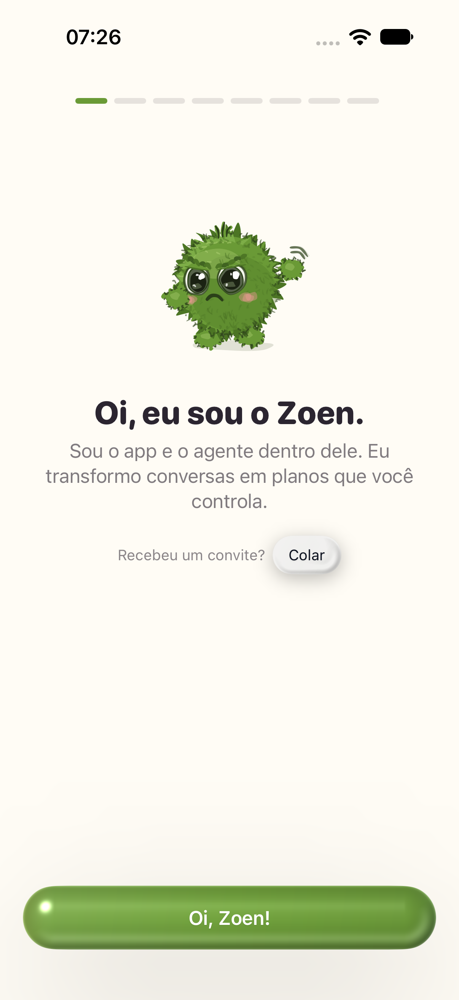
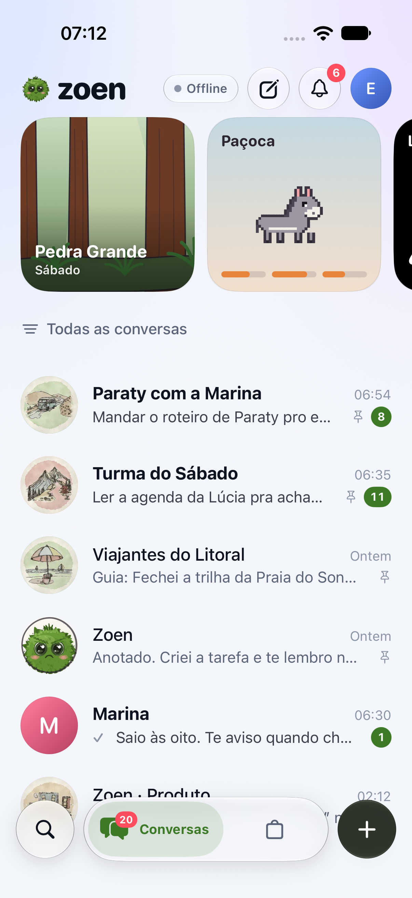
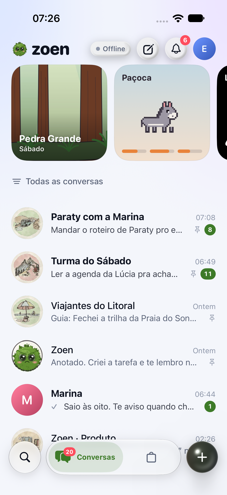
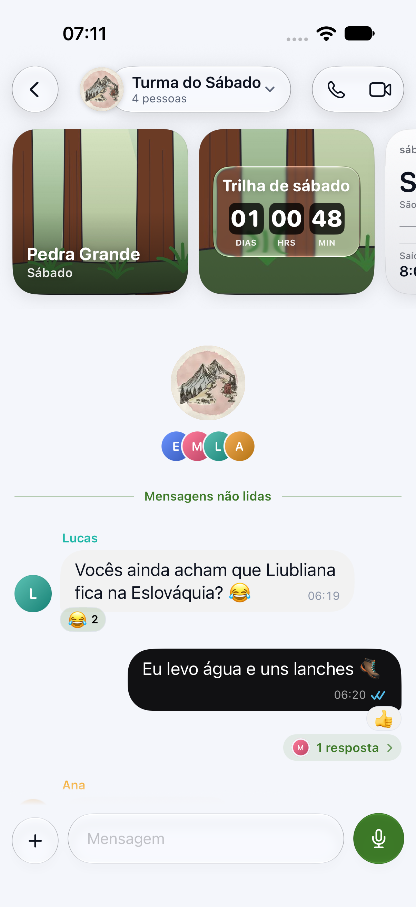
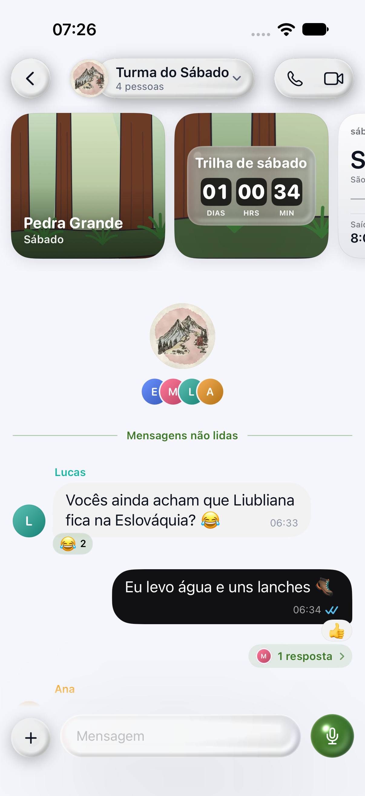

# Shared marble glass: second pass

Original rounded-lens math replaces the white colour-effect overlay. Apple now samples the local material field with a Metal `layerEffect`; Android uses the equivalent AGSL field. Both use IOR 1.5, quadratic edge displacement, ±0.04 RGB dispersion, Schlick Fresnel, a top-left glint, rim, inner shadow and opposite-side caustic. Full surfaces use 26% black shadow, offset (2,41), blur 60, spread -8; small controls have a shallower profile and compact shadow. Custom Apple glass surfaces now use the shared modifier rather than independent system glass effects. Native toolbar glass is system-owned.

The invite action uses the system `PasteButton`, with the secondary glass style and small control size. The system owns paste authorization; there are no direct clipboard reads. The earlier captures below predate this review correction; paste authorization behavior has not been exercised interactively.

## Verified captures

One iPhone 18 Pro simulator, iOS 27.0, Xcode at `/Applications/Xcode.app/Contents/Developer`. The simulator was shut down after capture. Screenshots are genuine XCTest attachments, not mockups; demo timestamps/countdowns differ between runs.

| Screen | Main before | Changed after |
| --- | --- | --- |
| Onboarding CTA + invite |  |  |
| Chats list |  |  |
| Group chat card |  |  |

## Checks

All commands used `DEVELOPER_DIR=/Applications/Xcode.app/Contents/Developer` where applicable.

- PASS: `python3 scripts/test-glass-optics.py` — four tests. Before replacement the integration contract failed because main had no sampled layer; after replacement all pass. CPU equation and source-contract checks are not GPU equivalence tests.
- PASS: `bash scripts/check-apple-glass.sh` — Metal compilation and Swift type checking for iOS and macOS.
- PASS before and after: `xcodebuild test -project apple/Zoen.xcodeproj -scheme ZoenUITests -destination 'platform=iOS Simulator,id=E748ECE3-BD66-46CF-A20E-00BEFB24EA2B' -derivedDataPath .reason/glass-build -parallel-testing-enabled NO -only-testing:ZoenUITests/UIPolishJourneyTests CODE_SIGNING_ALLOWED=NO` — two UI journeys, onboarding/chats scrolling, group/thread/actions; final run includes the localized, hittable invite action assertion.
- PASS: `git diff --check`.
- FAILED: full `ZoenMac` build — unchanged `PushBridge.swift:58` references `.ephemeral`, unavailable on macOS. No unrelated push-notification fix is included. The isolated macOS material checks pass.
- NOT RUN: Android build / runtime screenshots — Java runtime unavailable on this Mac. No SDK/JDK installation attempted.
- NOT VERIFIED: hosted CI, dark mode, reduced transparency, physical devices, Android GPU output, clipboard permission flow, visual parity with the reference video.

## PR #123 review corrections

- Merged `origin/main` with a merge commit, without rewriting history.
- Pet tab glass receives its local light/dark appearance, including the system-material background.
- Reduce Transparency composites prominent tints over an opaque appearance-local surface, including the store's 14% tint.
- Restored system `PasteButton` for invite links.
- Regenerated icon equivalence with `scripts/export-android-ink-icons.py --verify-ref HEAD --equivalence-output android/app/src/test/resources/ink-icons-source-equivalence.json` and pet output with `scripts/export-android-pet.py`; no generated file was hand-edited.
- Pet source verification compares sprite inputs independently against main while still requiring generated output to match the entire current source. This permits UI-only changes but rejects changes to original sprite inputs. Four gate regression tests cover equality, UI-only changes, changed inputs and a missing sprite boundary.
- PASS: three new glass source-contract regressions fail against the original PR head and pass after the correction; all seven optics/contract tests pass. These are not interactive accessibility or paste tests.
- PASS: `python3 scripts/check-android-upstream.py --source-only --output /tmp/zoen-upstream-review.json` reports `art_sources_match: true`, no errors. The pre-build source check does not certify generated ABI artifacts.
- PASS: `python3 scripts/test-android-art-equivalence.py` (four tests), `python3 scripts/test-android-core-contract.py` (six tests), and Apple shader/style compilation for both platforms.

## Material limitation

This is local-field refraction, not arbitrary backdrop capture: SwiftUI's system material rendered black when sampled inside `SwiftUI::Layer`, so the live blurred backdrop stays outside the lens shader. Compose's drawing modifier likewise has no backdrop texture. The lens bends a local tint/illumination field and adds volume on flat backgrounds; actual scene refraction behind the surface is still an unmet requirement. Do not describe this implementation as full backdrop refraction or claim Android/iOS pixel parity.

Generated bindings were produced only by `scripts/build-core.sh` and have no tracked diff. No force-push, merge, sudo or brew use. The personal `~/zoen/zoen-native` checkout was not accessed. Free disk remained above 263 GiB at the final check.
