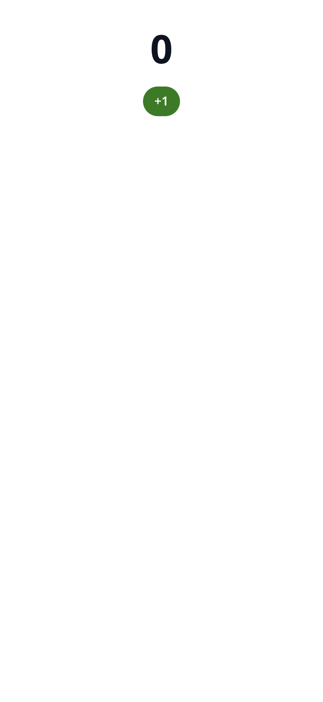

# Tutorial: build your first mini-app

You'll write **Tally** — a shared counter everyone in a chat sees — bundle it into one offline, hash-pinned HTML file with the repository's builder, and preview it headlessly. Along the way you'll learn the three things every Zoen mini-app has: a **manifest**, a **UI** that talks MCP Apps through the SDK, and **tools** in the core that own the shared state.

> **What you need:** Node.js 22+ and npm. For the headless preview, Google Chrome at `/usr/bin/google-chrome`.

## 1. Create the app folder

Mini-apps live in `miniapps/<id>/`:

```sh
mkdir -p miniapps/tally/src
```

`miniapps/tally/manifest.json`:

```json
{
  "id": "tally",
  "name": "Tally",
  "description": "A shared counter: everyone in the chat sees the same number.",
  "entry": "src/main.tsx",
  "capabilities": [],
  "allowedDomains": [],
  "linkDomains": [],
  "maxKB": 400
}
```

No capabilities, no network: this app can't reach the internet even if it tried — the host injects a CSP that only opens domains you declare **and** the person allows.

## 2. Write the UI

`miniapps/tally/src/main.tsx`:

```tsx
import { createRoot } from 'react-dom/client';
import '@zoen/ui/tokens.css';
import { zoen, useZoenState, useMembers, Pill, AvatarStack } from '@zoen/ui';

type Tally = { count: number };

function App() {
  const state = useZoenState<Tally>();   // live shared state: re-renders when anyone changes it
  const members = useMembers();          // who's in the chat
  const count = state?.count ?? 0;
  return (
    <main style={{ padding: 16, display: 'grid', gap: 12, justifyItems: 'center' }}>
      <AvatarStack members={members} />
      <h1 style={{ fontSize: 48, margin: 0 }}>{count}</h1>
      <Pill tone="brand" label="Add one" onClick={() => zoen.state.call('tally_add', { by: 1 })}>
        +1
      </Pill>
    </main>
  );
}

createRoot(document.getElementById('root')!).render(<App />);
```

`zoen.state.call` sends an MCP `tools/call`. The core checks the grant, applies the tool, signs a new version of the mini-app's Item and returns the new state to every member.

## 3. Bundle it

```sh
cd tools/miniapp-build
npm ci
node build.mjs ../../miniapps/tally --out /tmp/miniapps
```

```text
✓ tally: 190.9 KB (gzip ~60.9 KB) · sha256 3140dcb61a93… · 73 ms · deps scheduler@0.26.0, react@19.1.1, react-dom@19.1.1
```

You get `tally.html` (everything inlined: no `<script src>`, no remote stylesheet) and `tally.manifest.json` with its SHA-256. The host verifies that hash before loading the file. Without `--out`, the builder writes into the core's embedded bundle folder, `crates/roda-ffi/apps/`.

The builder refuses bundles that break the rules — unknown manifest keys, imports outside the allowlist or the app folder, remote URLs, or a size over `maxKB` ([manifest reference](../reference/miniapp-manifest.md)).

## 4. Preview it headlessly

```sh
cd ../miniapp-gen && npm ci
node -e "import('./render.mjs').then(m => m.render('/tmp/miniapps/tally.html', '/tmp/miniapps/tally.png')).then(r => console.log(r))"
```

```text
{ errors: [], text: '0\n+1' }
```



Outside a Zoen host there is no shared state, so the count shows `0` and the button can't change it yet. That's the next step.

## 5. Give it tools in the core

In Zoen today the **MCP server for built-in mini-apps runs inside the Rust core** (`crates/roda-ffi/src/apps.rs`). To make Tally live in a chat you add an `AppSpec` with:

- `id`, `name`, `description` and a `ui://…/tally` `resource_uri`;
- `html: Some(include_str!("../apps/tally.html"))` and its `manifest`;
- a tool the agent can call to create it (`visibility: ["model"]`), e.g. `start_tally`;
- a tool the UI can call (`visibility: ["app"]`), e.g. `tally_add`, with a JSON schema for `{ "by": integer }`, marked reversible;
- the state rules in the create/apply functions, next to the existing apps.

Study `countdown` (the smallest spec) and `schedule` (`crates/roda-ffi/src/apps/schedule.rs`, the richest rules) in that file. Remote MCP servers and a catalog, which will let mini-apps ship without touching the core, are **planned**.

> **Clean up** if you were just experimenting: `rm -rf miniapps/tally /tmp/miniapps`.

## What you learned

- A mini-app is an MCP Apps server: **tools + an HTML UI resource**, with Zoen as the host.
- Shared state is a **signed, versioned Item**; the UI never owns it.
- The bundle is **offline and hash-pinned**; network and native powers are declared, explained to the person and granted explicitly.

Read [Mini-apps (MCP Apps)](../technical/mini-apps.md) for the full host contract.
