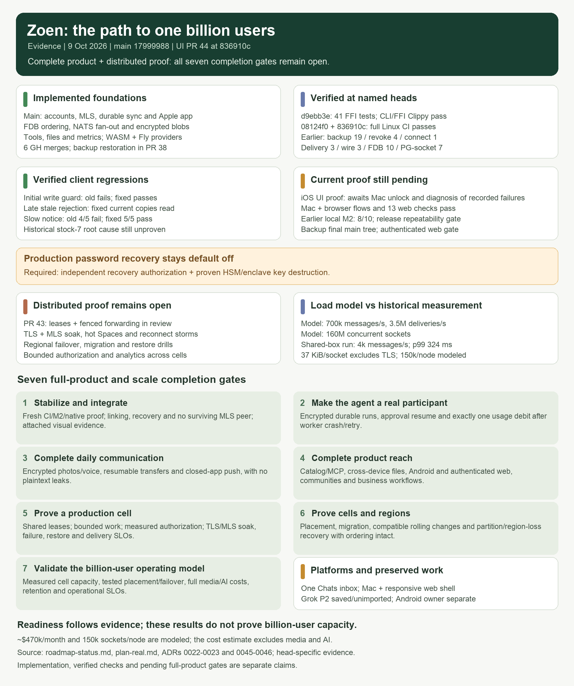

# Historical roadmap evidence, 9 October 2026

This is the previous dated audit. Its PR states, failures and local artifact paths describe that review only. For current implementation and verification, read [roadmap status](../roadmap-status.md). In particular, PR 45 has since restored backup on main and PR 43 has integrated durable ownership.

# Roadmap status: the path to one billion users

Evidence reviewed on 2026-10-09, against `main` at `17999988` and work in PRs
[#33](https://github.com/EnzoTironi/zoen-native/pull/33) through
[#45](https://github.com/EnzoTironi/zoen-native/pull/45).
GitHub records PRs 33, 34, 35, 36, 37 and 40 as merged. The examined `main` tree
does not contain PR 34's encrypted-backup implementation; reviewed PR 38 at `08124f0`
restores that integration and has [passing full Linux CI](https://github.com/EnzoTironi/zoen-native/actions/runs/37973200217).
The reviewed integration candidate `d9ebb3e`
has passing full Linux CI and remains a temporary, unmerged validation PR.
UI PR 44 now has one Chats inbox for direct, group and community conversations,
optional filters and Cards/List notification switching. Functional head `836910c` has
[passing full Linux CI](https://github.com/EnzoTironi/zoen-native/actions/runs/37980360708),
passing iOS/macOS builds, 13 web checks and running Mac/browser journeys. The later
`159a2f2` only updates native Chats wording and Portuguese translations; the string
catalog and diff checks pass, and fresh-head CI is required before integration.
Full iOS interaction proof remains pending: recent runs recorded render/accessibility stalls and a nonmoving scroll gesture. Computer-use
tooling subsequently detected the Mac was locked; further UI checks await unlock and
failure diagnosis. A temporary rendering treatment is not part of the reviewed head.
A controlled earlier AtTheEnd journey passed after deferring initialization of the
inactive Search screen.
Results are tied to named heads; earlier local M2 failures remain recorded below.
The target is the complete product at one billion monthly users.
The original prototype schedule in [repensado.md](../repensado.md) does not determine readiness.

## Current position

Zoen has real encrypted messaging foundations, a native Apple app, staging infrastructure,
and several tested building blocks for agents, files and growth. It is still completing
the product and its distributed infrastructure. A screen, an accepted ADR,
a passing unit test and a deployed journey are different kinds of evidence.

| Area | Implemented on main | Remaining completion gate |
|---|---|---|
| Accounts and sync (M1) | Device identities, signed binary events, durable outbox, paged sync, real relay and native account flow; [staging journey](https://github.com/EnzoTironi/zoen-native/blob/5149ae48be3b104fbe23b4e6a91bef80f131844c/scripts/journey-staging.sh) | Repeatable release journeys across devices, interruptions and upgrades; account lifecycle and recovery UI |
| Encryption (M2) | OpenMLS DMs/groups by default, membership removal, concurrent commit handling, sealed local state, reviewed pruning and explicit device enrollment; reviewed encrypted backup/recovery awaits restoration through PR 38 | Finish native linking/recovery UI and verify revocation and recovery through subsequent messages, including no surviving authorized MLS peer |
| Relay scale (S1–S9) | FDB ordering, dedupe, per-Space batching, NATS two-node fan-out, rate limits, telemetry, load harness | Shared leases and placement, crash-safe durable forwarding, cell routing, migration and regional failover proofs |
| Agent tools | Grants, signed tool manifests, budgets, sandbox lifecycle, gVisor/Firecracker/browser backends and merged WASM/Fly Machines providers | Real agent identities and MLS membership, durable model/tool run loop, approval resume, idempotent usage ledger, model gateway (M3); paid Fly staging and egress validation |
| Media (M4) | Encrypted blob transport, backgrounds, profile photos and Item blobs | Photos and voice messages through the same transport, interrupted/resumed transfer, real S3 integration journey |
| Push (M5) | Planned protocol and delivery design | Token registration, APNs worker, encrypted notification extension, simulator and HTTP/2 sink journeys, then physical-device validation |
| Files and apps | Loro documents, file viewers/editors, pages, declarative view types and local mini-app examples (ADRs 0040–0042) | Multi-device editing and agent approval journeys, complete permissions, remote MCP interoperability, signed catalog publishing/search/install (M6) |
| Growth and analytics | Invite mechanics, MAU/sent-message counters, retention reports, source attribution, experiment assignment/exposure foundations (ADRs 0043–0044) | Client flows per acquisition source, experiment guardrails, stronger invite eligibility, partitioned/columnar analytics and validated cell-level aggregation |
| Platforms and distribution | Native iOS/macOS; real staging in Fly gru behind Cloudflare | Android and functional web client, universal links/passkeys, notification entitlements, release and compatibility testing |
| Communities and commerce | Product design and UI foundations | Real discovery, moderation/reporting, creator/community workflows, business agent integrations and payment/credit ledger |
| Operations (M7) | Infrastructure files, migrations, local relay stack, health endpoints and telemetry | Whole-stack deployment including agents/push, restore drills, SLO alerts, capacity admission, chaos and regional recovery drills |

Main evidence: [plan-real.md](../plan-real.md), [system-design.md](../system-design.md),
[product vision](../product/vision.md), [UX audit](../product/ux-audit.md), and the named journey
tests under `crates/zoen-cli/tests` and `apple/UITests`. Rows describe implementation,
not a fresh rerun of every historical test.

## What the scale evidence proves

The [load model](../plan-real.md#scale-built-for-a-billion-people) assumes 500 million daily
users, 700,000 peak messages/second, 3.5 million peak device deliveries/second and 160
million concurrent sockets. These are design inputs.

[ADR 0022](../adr/0022-capacity.md) and [ADR 0023](../adr/0023-per-space-sequencer.md) measure
a shared development box over short runs. The S9 sweep delivers 4,000 messages/second
with p99 324 ms, above the system design's in-region 200 ms delivery goal. One hot Space
tops out near 3,180 messages/second. The 37 KiB/socket measurement excludes TLS; 150,000
sockets per node is a planning assumption. The approximately $470,000/month estimate is
an extrapolation that excludes media and AI, not a production bill or capacity proof.

`NodeOwner::claim_all` in `crates/zoen-relay/src/ownership/mod.rs` grants all 4,096
partitions to each process using an in-memory lease table and a one-year expiry.
FDB head conflicts protect ordering across racing relays; there is no shared ownership
handoff yet. The system design's two-second lease failover remains a target.

A separate user-owned backend workstream is implementing persisted renewable leases,
transaction fencing and bounded forwarding in [PR 43](https://github.com/EnzoTironi/zoen-native/pull/43).
At reviewed head `3fe1ef5`, [full Linux CI passes](https://github.com/EnzoTironi/zoen-native/actions/runs/37982274653),
including nine ownership assertion groups, ten real-store journeys and seven session
revocation tests. The later `eff2eadd` addresses five source-review findings: registry
cleanup/admission, complete inbound forwarding deadlines, reply metadata bounds, invite
byte accounting and atomic failure of queued descendants after permanent genesis rejection.
Independent source review checked those changes. The owner reports 15 real-service
ownership assertion groups passing; fresh full CI is running at that head. These local
results remain workstream reports, and the reviewed fixes have not been integrated.

Two further service gaps remain before integration: the public WebSocket membership
lookup has no complete Postgres deadline, and a forwarding timeout followed by a durable
duplicate acknowledgement can omit live recipient delivery and `Joined`. The regression
must exercise the public WebSocket path, recover pool capacity while the lock is still
held, preserve retryable database failures, and deliver the committed event to currently
authorized recipients without appending it twice. Earlier local FDB startup error 1031
and short-lease renewal instability remain recorded. None of these checks closes workload,
authenticated TLS, production-cell or regional recovery gates.

The analytics hot path already batches counters in RAM every 15 seconds.
Account/Space daily rows still accumulate in Postgres.
The design needs explicit memory bounds, retry/idempotency semantics, cell aggregation,
retention costs and reporting latency at the load model above.

## Work in flight

[Read the work-in-flight section](roadmap-2026-10-09-work-in-flight.md).

## Execution order and acceptance gates

These are completion gates, not an MVP cut. Product and distributed infrastructure can
advance together once their common encrypted messaging boundary is reliable.

1. **Stabilize and integrate the existing work.** Close the live-refill failure, preserve
   unfinished UI changes, integrate reviewed linking/backup and sandbox work without ADR
   or migration collisions. Exit: combined-tree CI, release simulator journeys and attached
   visual evidence for each behavior; linking, history, recovery and revocation work through
   the native app, including the case with no surviving authorized MLS peer. Production
   password recovery also requires independent recovery authorization and proven key
   destruction before public activation.
2. **Make the agent a real participant.** Build the approved Rust/FDB/JetStream runtime,
   keeping the model provider behind Zoen-owned traits. Exit: an MLS group member asks the
   agent, receives its encrypted reply, approves an otherwise refused tool, and sees one
   usage debit even after a worker crash/retry. Prove it with a scripted model endpoint,
   then a configured live provider.
3. **Complete daily communication.** Finish encrypted photo/voice delivery, resumable
   transfers and push. Exit: a recipient with the app closed receives a notification,
   opens the message/media, survives a network interruption and remains in sync; storage,
   pushes and telemetry contain no message plaintext.
4. **Complete product reach.** Finish signed catalog/MCP installation, cross-device files,
   Android/web onboarding and invite links, community moderation and business workflows.
   Exit: each promised flow works between independent accounts and platforms with scoped
   permissions, accessibility and supported client versions.
5. **Prove a production cell.** Replace process-local ownership with shared, renewable
   leases and fenced forwarding. Bound queues/caches and authorization work, test hot Spaces
   and reconnect storms, measure Postgres authorization capacity and backup cleanup, and
   isolate the load generator. Exit: agreed SLOs hold with TLS and MLS-sized payloads
   during a soak, a relay/NATS/storage failure, and restore from backup. Record offered,
   accepted and delivered work separately with exact reconciliation.
6. **Prove cells and regions.** Implement directory/cell placement and migration, DR and
   version-compatible rolling changes. Exit: concurrent writers, duplicate delivery,
   network partitions and region loss preserve ordering, membership and recoverable
   messages with measured recovery objectives.
7. **Validate the billion-user operating model.** Aggregate analytics by cell, run
   representative mixed workloads and measure full costs including media, model use and
   replication. Exit: demonstrated cell capacity multiplied by tested placement/failover
   limits satisfies the load model with stated headroom; growth experiments preserve
   retention and operational SLOs. Keep modeled, measured and deployed numbers distinct.

## External activation

Apple signing capabilities/APNs credentials, a live model provider and paid sandbox
deployment activate their respective live checks. Their absence does not prevent local
protocol, runtime, simulator or failure testing. GitHub Actions is currently running:
the old private-repository billing blocker in the plan is stale.

The ongoing product metrics remain **MAU and sent messages per user**, interpreted with
retention, delivery success, privacy and cost. A completion percentage would hide the
largest unproven gates; track their evidence instead.
