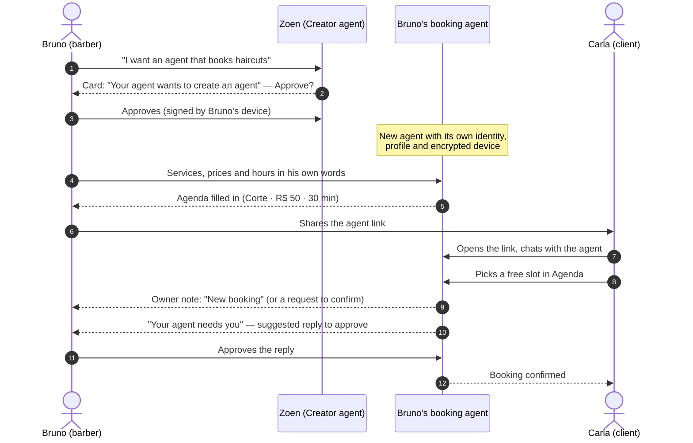

# Roadmap

Zoen tracks progress **per gate, with evidence** — not with a completion percentage. This page is the readable summary; the evidence ledger with exact commits, CI runs and test counts is [roadmap status](../roadmap-status.md), and the latest checkpoint is the [12 October handoff](../dev/handoff-2026-10-12.md).

## Two products, one name

| | Zoen v1 | Zoen v2 (`zoen-native`, this repository) |
| --- | --- | --- |
| Where | Inside WhatsApp | Its own native messenger: iPhone, Mac, Android, web |
| Status | **Live**, with real users | **Pre-launch** — no production users or data yet ([prelaunch policy](../dev/prelaunch-policy.md)) |
| Role | Proves people want an assistant inside their conversations | Rebuilds communication so conversations can produce plans, pages, apps and agents, privately |

## First native release scope

The first release of v2 is built around one promise — *a conversation that turns into something* — and one end-to-end business journey: **the barber's booking bot**.

### Journey: the barber builds his booking bot

This journey is exercised by real code on `main`: the Agenda mini-app (`crates/roda-ffi/src/apps/schedule.rs`, `miniapps/schedule/`), the Creator agent (`crates/zoen-agentd/src/citizen/creator.rs`), agent links (`crates/zoen-cli/tests/journey_agent_link.rs`) and owner notes (`crates/roda-ffi/src/agent_notes.rs`).

| Step | What happens | Status |
| --- | --- | --- |
| 1. Describe the agent | The Creator agent turns the owner's words into a persona, rules and state — no hard-coded "barber" logic. | **Built** (prompt-driven) |
| 2. Approve it | The new agent only starts working after the owner approves; registration needs the owner's signed device proof. | **Built** |
| 3. Configure Agenda | Business name, services, prices and weekly hours, in the business time zone. | **Built** |
| 4. Share the link | One stable link per agent, with a public page; revocable, with expiry and a use limit. | **Built** |
| 5. Client books | Free slots only; no overlaps, no past or far-future times, at most 2 open bookings per client. Clients see busy times, never other clients' names. | **Built** |
| 6. Conflicts | If someone takes the slot a moment earlier, the client is asked to pick another time. | **Built** |
| 7. Owner is told | "New booking" / "Booking cancelled" owner notes; special requests become events the agent or owner resolves. | **Built** |
| 8. Approval before replying | Suggested replies wait on a "Your agent needs you" card. | **Built** in the core and native cards |
| 9. Agent runs while the owner is offline | A hosted runtime holds the agent's device on the relay. | **In progress** — productive model/tool lifecycle and managed custody are open |
| 10. Payments | Charging clients, Pix, credit ledger. | **Planned** |

  
  
  

*Client view, owner view with pending requests, and the approval cards on iOS — screenshots from the repository's journey evidence.*

### Everything else in the first release

| Area | Built on `main` | Still open |
| --- | --- | --- |
| **Messaging** | Accounts, signed events, durable outbox, relay sync, OpenMLS encryption, replies, threads, receipts, reactions, search/edit/delete. | Compatible production rollout and release journeys. |
| **Devices and recovery** | Linking with history transfer, revocation, encrypted backup with a 64-digit recovery key, recovery after losing every device. | Native recovery/device controls on every platform; production backup authority. |
| **Relay** | Ownership leases, fencing, bounded forwarding, retry deduplication, abuse limits, content-free telemetry. | TLS workloads at scale, cell placement, regional recovery, SLOs, full costs. |
| **Apple** | Unified Chats, themes, pinned cards, notifications cards, keyboard controls, motion and accessibility settings checks. | Physical-device and Release journeys, bounded media, full HIG pass, system Liquid Glass. |
| **Android** | Kotlin/Compose app on the same core; demo and real-account flows; CI on API 28 and 35. | Fresh bindings and device journeys on current `main`; release; public relay compatibility. |
| **Web** | Authenticated browser client source with phone pairing, portable MLS and encrypted local storage. | Real pairing/messaging journeys, reload/reconnect, shared editor. |
| **Live Pages and Plans** | Shared document session, encrypted drafts and versions, typed Plan reads. | Canonical Plan writer and approvals, full block UX, comments, nested pages. |
| **Agents** | Owner authorization, approvals, Creator, agent links, model gateway, sandbox tiers. | Productive model/tool/approval lifecycle, managed custody, provider reconciliation. |
| **Media and push** | Encrypted blob transport. | Photo/voice delivery, APNs/FCM. |

## Milestones

| Milestone | Theme |
| --- | --- |
| **M1** | Relay, real accounts, sync |
| **M2** | End-to-end encryption with OpenMLS; linking, backup, recovery |
| **M2.5–M2.7** | Hooks; files and memory; editors, Live Pages and dynamic UI |
| **M3** | Real agents |
| **M4** | Client-side encrypted media |
| **M5** | Push |
| **M6** | Store and catalog |
| **M7** | Deploy-ready |

Full definitions live in [plan-real](../plan-real.md).

## Completion sequence

From the [roadmap status](../roadmap-status.md#completion-sequence):

1. Publish verified units; fix the open file-import failure, regenerate core bindings, finish recovery/linking, Android release/device and HIG journeys.
2. Finish the canonical Plan/approval migration, authenticated web and cross-client interoperability.
3. Managed custody and the durable productive agent lifecycle; reconcile live provider usage.
4. Independent-device encrypted photo/voice and push.
5. Shared files, remote MCP/catalog, communities and commerce.
6. Prove production cells under mixed TLS load, hot chats, reconnects and failures.
7. Prove placement/migration, rolling upgrades, restore and regional failure.
8. Validate sustained capacity, headroom and complete costs against the scale model.

## Planned, not built

These are decided or designed but have **no implementation on `main`**:

- A sky background that follows the person's local time — implemented in [PR #127](https://github.com/EnzoTironi/zoen-native/pull/127) (`ui/living-sky`), open, not merged.
- Remote MCP servers, catalog and Store ([ADR 0042](../adr/0042-dynamic-ui.md)).
- Hooks runtime ([hooks](../hooks.md)).
- Calls and live video.
- Payments, commerce and the credit ledger for businesses.
- Community discovery and moderation.

## Scale targets are inputs, not results

The [load model](../plan-real.md#scale-built-for-a-billion-people) is designed for one billion monthly users. Its numbers are **design inputs**. Short development-box measurements are recorded in [ADR 0022](../adr/0022-capacity.md) and [ADR 0023](../adr/0023-per-space-sequencer.md); they do not establish production capacity or cost.
