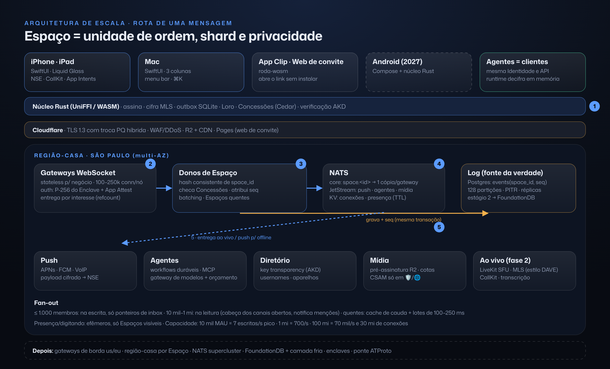

[Índice](../repensado.md) · [Anterior](03-experiencia.md) · [Próximo](04a-cliente-apple.md)

## 4. Como construir: arquitetura e tecnologias

### Princípio: os mesmos primitivos do pixel ao disco
- O **núcleo em Rust** implementa Identidade, Espaço, Membro, Item, Concessão e o log de Eventos **uma vez**. Ele roda no cliente Apple (iOS/macOS via UniFFI), na web de convite (WASM), no Android, com o cliente nativo já em revisão em 2026, no servidor e no runtime de agentes.
- O servidor é um **relay**: ordena, guarda e distribui eventos, sem regra de negócio duplicada.
- Um agente é **um cliente como outro qualquer**: tem Identidade, entra em Espaços como Membro e usa a mesma API.

### Diagrama do sistema

Detalhes de escala e segurança em §5.

### Paridade de recursos (WhatsApp / iMessage / Slack / Ando) mapeada nos primitivos
| Recurso | Como sai dos primitivos |
|---|---|
| Mensagens, respostas, reações, editar/apagar, encaminhar, enquetes, localização, figurinhas | Itens e eventos no log do Espaço (editar = nova versão; apagar = evento de tombstone) |
| Mensagens temporárias, visualização única | Concessão com prazo no Item, mais apagamento local |
| Confirmação de entrega/leitura, digitando, presença | Eventos efêmeros (não persistidos) |
| Grupos, comunidades e canais do WhatsApp; canais e threads do Slack | Espaços e Espaços-filhos, públicos ou privados |
| Status/Stories | Itens com prazo de 24 h no seu Espaço público (fase 3) |
| Ligações, vídeo, tela, huddles, SharePlay, Jams do Ando | Modo Ao vivo de qualquer Espaço |
| Canvas e Lists do Slack, docs | Item com CRDT |
| Slack Connect, Bridge channels do Ando | Nativo: um Espaço não pertence a uma empresa, e membros de organizações diferentes são só Membros |
| Apps, workflows e integrações do Slack; MCP/API/webhooks do Ando | Agentes como Membros, com ferramentas MCP, e Concessões |
| Curations do Ando (contexto) | Itens + Concessão de leitura para o agente (Memória) |
| Proatividade por canal do Ando | Nível de confiança + "frequência" por Espaço |
| Admin, SSO, SCIM, retenção, eDiscovery | Concessões de organização sobre Espaços (fase 5) |
| Apple Pay no iMessage | Pix e cartão dentro da conversa como Item "cobrança" (fase 3) |

### Plano de tecnologia por área
Cada área traz a escolha para o v1, a evolução, se é comprar ou construir, e o principal tradeoff.

**1. Clientes**
- **Decidido (D2):** iOS 26+ e macOS 26+ 100% SwiftUI com Liquid Glass real, núcleo Rust via UniFFI, web só para convites (WASM) + App Clip, e Android em 2027 (Compose sobre o mesmo núcleo). Detalhes em **§4A Cliente Apple nativo**.
- **Descartados:** Flutter (sem Liquid Glass fiel) e React Native/Expo (cripto, extensões e background fracos).

**2. Tempo real e sincronização**
- **v1:**
  - **WebSocket/TLS** com frames **protobuf** (prost).
  - Cada Espaço tem um **log append-only** com **número de sequência atribuído pelo relay**, o que dá ordem total por Espaço. Cada evento é **assinado** pelo autor e encadeado por hash.
  - Cliente **offline-first**: **SQLite** local (SQLCipher no mobile; SQLite-WASM com OPFS na web). A fila de saída tem idempotência por ID de cliente (ULID).
  - **Multi-aparelho:** cada aparelho tem a própria subchave, e a sincronização é por cursor de sequência.
  - Recibos e digitando são **eventos efêmeros** via **NATS**. A entrega é confirmada pelo ack do relay. A leitura é um evento cifrado e opcional.
- **Depois:** **WebTransport/QUIC** em redes móveis ruins.
- **Construir** o relay (é o coração e é pequeno), **comprar** o NATS (Synadia Cloud ou self-host).
- **Tradeoff:** ordem por servidor é simples e robusta. Ordem causal pura (sem servidor) é mais soberana, mas complica tudo; fica para os hosts alternativos.

**3. Criptografia de ponta a ponta**
- **v1:** **MLS (RFC 9420) via OpenMLS** (Rust, licença MIT) para DMs e grupos até ~2–5 mil membros: um protocolo para 1:1 e para grupos, com escala logarítmica e forward secrecy/PCS. Espaços **públicos** e comunidades grandes usam cifra em trânsito e em repouso, legíveis pelo servidor (como canais do Telegram e o Slack), com um selo claro na UI.
- **Agentes em Espaços cifrados:** o agente é **membro MLS com chave própria**, e o runtime dele guarda essa chave. Isso torna explícito que **adicionar um agente = adicionar um leitor**; a UI diz *"Financeiro lê esta conversa · roda em Nuvem do app"*. Há uma opção por Espaço: "só agentes locais" (modelos no aparelho).
- **Depois:** runtime confidencial (**AWS Nitro Enclaves** e GPUs com computação confidencial, com atestação remota) para que nem o operador veja. Também **message franking** para denúncias verificáveis em Espaços cifrados.
- **Construir** sobre o OpenMLS. Por que não **libsignal:** é AGPL e foi pensado para 1:1 e grupos pequenos.
- **Tradeoff:** agentes inteligentes precisam ler, e ser honesto sobre isso é o diferencial frente a Ando e Slack, que leem tudo.

**4. Mídia**
- **v1:**
  - Upload direto para **Cloudflare R2** (sem custo de egress) com URL pré-assinada e **cifra no cliente** (AES-GCM por arquivo, chave dentro do evento).
  - Miniaturas e transcodificação **no cliente** (AVFoundation/MediaCodec, com H.264/HEVC). Notas de voz em **Opus**, com transcrição no aparelho.
  - **CDN Cloudflare.**
- **Depois:** mídia pública das comunidades transcodificada no servidor (**Cloudflare Stream** ou **Mux**).
- **Comprar** armazenamento e CDN.
- **Tradeoff:** com E2EE o servidor não pode gerar miniaturas, então o cliente trabalha mais.

**5. Voz, vídeo e Ao vivo**
- **v1:** **LiveKit Cloud** (SFU WebRTC, open source) com E2EE por insertable streams. **CallKit/PushKit** no iOS e ConnectionService no Android. Agentes entram como participantes via **LiveKit Agents**, com STT/TTS e interrupção natural.
- **Transcrição:** no aparelho (SpeechAnalyzer do iOS 26 ou Whisper) em Espaços cifrados; no servidor (**Deepgram** ou Whisper) nos públicos. Gravação via **LiveKit Egress**, só com consentimento explícito e em Espaço não cifrado.
- **Depois:** self-host do LiveKit para custo.
- **Comprar**, depois self-host.
- **Tradeoff:** gravação/transcrição no servidor e E2EE são incompatíveis; a UI precisa deixar a escolha clara.

**6. Documentos colaborativos**
- **v1:** **Loro** (CRDT em Rust) para rich text, listas e árvores. Ele tem **histórico, checkout de versões e bifurcações nativas**, ou seja, Versões, Cenários e Comparar saem quase de graça. Os updates viajam como eventos cifrados no log, com snapshots periódicos.
- **Editor:** **nativo**, com `TextEditor` + `AttributedString` (rich text do iOS 26) ligado ao Loro. O TipTap fica só na web de convite.
- **Depois:** TextKit 2 para casos avançados (tabelas, blocos).
- **Construir** em cima do Loro.
- **Tradeoff:** o Loro é mais novo que o **Yjs** (ecossistema maior), mas o Yjs é JS-first e tem histórico fraco. O **Automerge** é a alternativa Rust, porém mais lento em texto grande.

**7. Notificações push**
- **v1:** **gateway próprio** para **APNs e FCM** (e Web Push). O payload é só o evento cifrado ou um "acorde + id". A **Notification Service Extension** do iOS decifra com o núcleo Rust (limite de ~24 MB de memória, então o núcleo precisa de um modo enxuto), e Communication Notifications mostram avatar e nome. No Android, data messages no FCM.
- **Construir** (é pequeno). Por que não OneSignal: metadados sensíveis.
- **Tradeoff:** E2EE exige decifrar no aparelho, o que exige engenharia de extensão.

**8. Busca**
- **v1:** **no aparelho** com **SQLite FTS5** (tokenização com acentos PT) para tudo que é cifrado, e **sqlite-vec** com embeddings pequenos (Core ML) para busca semântica local. No servidor, **Postgres FTS + pgvector** para Espaços públicos e Explorar.
- **Depois:** **Typesense/Meilisearch** ou OpenSearch quando Explorar crescer.
- **Tradeoff:** a busca cifrada é por aparelho, e o histórico antigo precisa ser sincronizado para ser buscado.

**9. Threads, canais e huddles (estilo Slack)**
- **v1:** tudo é **Espaço-filho**: uma thread é filho de uma mensagem e um canal é filho de uma comunidade. O huddle é o modo Ao vivo do canal. Mensagens agendadas e lembretes são eventos com data. Os workflows **são agentes**.
- **Fase 2:** importadores de Slack e WhatsApp (export .zip) para trazer equipes.
- **Tradeoff:** um modelo só é mais elegante, mas o desempenho de listas com muitos filhos precisa de índice dedicado.

**10. Runtime de agentes**
- **v1:**
  - Cada agente é uma Identidade com um **Item "definição"** versionado: instruções, ferramentas, fontes e modelo.
  - Um serviço de runtime se inscreve nos Espaços onde o agente é Membro e roda tarefas em **workflows duráveis** com **Restate** (leve, binário único, Rust). Isso cobre retries, espera por aprovação e timers. Alternativa: **Temporal**.
  - Ferramentas via **MCP**, e qualquer agente externo entra pela mesma API (BYO agent, como no Ando).
  - Código e navegação rodam em **sandboxes microVM** (**E2B** ou **Modal** no v1; Firecracker próprio depois).
  - **Concessões** são checadas antes de cada ferramenta e cada recuperação de contexto, com o **mesmo avaliador** do núcleo (políticas em **Cedar**, que é Rust e roda igual no cliente e no servidor).
- **Modelos:** um **gateway de modelos** próprio e fino (roteia OpenAI/Anthropic/Google; aceita chave própria do usuário). Ele **pré-autoriza o custo estimado contra o orçamento** (que é uma Concessão com limite) e debita o real num evento de uso. Modelos **no aparelho** (Apple Foundation Models) cobrem resumos e privacidade.
- **Memória/RAG:** conhecimento = Itens. Os embeddings guardam **a origem e a Concessão de cada trecho**, e a recuperação filtra pelo que o agente pode ler. Uma revogação apaga os derivados (#090 vira uma regra). A Memória fica visível e editável em Você.
- **Construir** o runtime e o gateway (são o produto); **comprar** sandboxes e modelos.
- **Tradeoff:** proatividade ("o agente decide falar") precisa de um roteador anti-loop entre agentes, como o Ando já aprendeu.

**11. Identidade, chaves e backup**
- **v1:**
  - Chave raiz **Ed25519** em software (cifrada pela passkey) e **chaves de aparelho P-256 no Secure Enclave**, que só suporta P-256. Login e recuperação com **passkeys (WebAuthn)**, usando a **extensão PRF** para cifrar o backup da chave raiz, que sincroniza pelo iCloud Keychain ou Google Password Manager.
  - Código de recuperação opcional. Aparelhos novos entram por **QR**.
  - Descoberta por username, link e (opcional) telefone/e-mail com hash e rate limit.
- **Depois:** assinador externo (NIP-46/hardware) e chave **secp256k1** derivada para a ponte Nostr.
- **Construir** sobre as APIs do sistema.
- **Tradeoff:** passkey cria dependência do ecossistema Apple/Google para recuperar, mas é o único jeito de ter soberania sem fricção.

**12. Pagamentos** (decidido, D12)
- **Brasil (iOS 26.5, acordo com o CADE):** oferecer a IAP é obrigatório, e é permitido **processador alternativo dentro do app** (Pix/cartão via Stripe ou PSP) com o entitlement StoreKit External Purchase.
  - **IAP:** 21% de comissão (10% no Small Business Program e em assinaturas após o 1º ano), mais **5%** de processamento da Apple.
  - **Processador alternativo:** a mesma comissão, sem os 5%.
  - **Link para fora:** 15% (ou 10%) sobre as vendas feitas até 7 dias depois do toque.
  - Fonte: Apple Developer, "Payment options on the App Store in Brazil".
- **EUA:** IAP + link para checkout web (*a verificar o status do recurso judicial de 2025*). **Resto:** IAP.
- **Criadores:** Stripe Connect + split de Pix via PSP brasileiro.
- **Lightning:** fora do v1.
- **Tradeoff:** taxa da loja contra conversão. O Pix dentro do app tende a ganhar no Brasil.

**13. Moderação e abuso**
- **v1:**
  - Denúncia em todo lugar (#023), com moderadores por comunidade (Membros com Concessão de moderar) e um **agente moderador** como Membro, que é elegante e configurável.
  - Para conteúdo público: classificadores (OpenAI Moderation ou Hive) e **hash de CSAM** (ferramenta da Cloudflare/PhotoDNA).
  - Limites para contas novas e reputação pelo grafo de convites.
- **Em Espaços cifrados:** a denúncia envia evidência decifrada pelo denunciante; message franking vem depois.
- **Lei:** **Marco Civil** (guarda de registros de acesso por 6 meses) e **ECA Digital (Lei 15.211/2025)**, que exige verificação de idade e proteção de menores em redes sociais.
- **Comprar** classificadores, **construir** fluxos.
- **Tradeoff:** feed público = custo de moderação permanente. Esse é o motivo de ele ficar na fase 3.

**14. Observabilidade**
- **v1:** **OpenTelemetry** em tudo, enviado para o **Grafana Cloud**; **Sentry** para crashes; e **PostHog** para produto e **LLM analytics** (já está no stack de vocês). **Nunca** capturar conteúdo: só eventos e métricas.
- **Comprar.**
- **Tradeoff:** em E2EE, o debug é cego; o investimento em telemetria estruturada precisa vir desde o início.

**15. Infra, hosting e escala**
- **v1 (time de 2–4 pessoas):**
  - **Fly.io** na região GRU, para relay, push, runtime e gateway.
  - **Postgres gerenciado em São Paulo**, com o log particionado por Espaço.
  - **NATS JetStream**, **Cloudflare** (borda, R2, CDN, Workers para links públicos) e **LiveKit Cloud**.
  - IaC com **Terraform**.
- **Escala:**
  - Shard de Espaços por hash entre nós de relay.
  - O Postgres aguenta até dezenas de milhões de eventos/dia. Depois, o log vai para **ScyllaDB** ou **FoundationDB**, e entram regiões múltiplas e AWS para enclaves.
- **Tradeoff:** começar gerenciado custa mais por usuário, mas economiza o recurso mais caro, que é o time.

**16. Conformidade (LGPD e afins)**
- Encarregado (DPO), registro de operações e lista de suboperadores.
- **Contratos com provedores de IA com retenção zero** e cláusulas-padrão da ANPD para transferência internacional (Res. 19/2024).
- Direitos do titular nativos: **Você › Dados** exporta e apaga. Retenção = Concessões com prazo.
- **Minimização**, que a E2EE ajuda a provar.
- ECA Digital, Marco Civil e termos de criador/marketplace (repasses, nota fiscal, impostos).
- **Depois:** SOC 2 e ISO 27001 para equipes e empresas.

### Tabela do stack (v1 → depois)
| Área | v1 | Depois | Comprar/Construir |
|---|---|---|---|
| Núcleo | Rust (UniFFI, WASM) | — | Construir |
| iOS/macOS | SwiftUI (iOS/macOS 26+) + Liquid Glass + extensões | watchOS/visionOS | Construir |
| Android | — | Compose + núcleo Rust (2027) | Construir |
| Web | Só web de convite (WASM) + App Clip | Web completo (2027+) | Construir |
| Transporte | WebSocket + protobuf | WebTransport/QUIC | Construir |
| Relay/servidor | Rust (axum, tokio) | Shards, hosts alternativos | Construir |
| Fila/efêmeros | NATS JetStream | — | Comprar/OSS |
| Banco | Postgres particionado (+ pgvector, FTS) | FoundationDB (alt.: ScyllaDB) | Comprar/OSS |
| Local | SQLite/SQLCipher, FTS5, sqlite-vec | — | OSS |
| E2EE | OpenMLS | Enclaves, franking | OSS + construir |
| Docs | Loro + editor nativo AttributedString | TextKit 2 | OSS |
| Mídia | R2 + CDN Cloudflare | Stream/Mux para público | Comprar |
| Ao vivo | LiveKit Cloud + Agents | LiveKit self-host | Comprar → OSS |
| Push | Gateway próprio APNs/FCM | — | Construir |
| Agentes | Restate + MCP + E2B/Modal + Cedar | Firecracker próprio, enclaves | Construir + comprar |
| Modelos | Gateway próprio (multi-provedor, BYOK) + on-device | Modelos próprios ajustados | Construir |
| Identidade | Raiz Ed25519 (passkey PRF) + P-256 no Secure Enclave + AKD | Assinador externo, DID ATProto | Construir |
| Pagamentos | StoreKit 2 + Pix via processador alternativo (BR) + Stripe | Connect + split de Pix (criadores) | Comprar |
| Moderação | Hive/OpenAI + hash CSAM + agente moderador | Franking | Comprar + construir |
| Observabilidade | OTel + Grafana + Sentry + PostHog | — | Comprar |
| Hosting | Fly.io GRU + Cloudflare | Multi-região, AWS | Comprar |

### Nostr/relays agora ou servidor convencional primeiro?
**Servidor próprio primeiro, com protocolo pronto para portabilidade.**
- Mensagem privada em Nostr vaza metadados, e grupos grandes ali ainda são imaturos.
- Um relay próprio dá push, ordem, entrega, anti-abuso e velocidade de produto.
- O que preservamos desde o dia 1 são três coisas: **eventos assinados pelo autor**, **log exportável** e **identidade de chave**. Com elas, mover um Espaço para outro host (#128) vira engenharia, não reescrita.
- **Fase 4:** a presença pública ganha uma **ponte AT Protocol** (e Nostr como opção). O veredito completo está em §7 Protocolos.
- **Atalho elegante: o Marmot** (MLS + identidade de chave Nostr + payloads em formato de evento) já foi desenhado **agnóstico de transporte**, e a spec prevê Nostr e QUIC. Podemos adotar o mesmo formato de grupo **sobre o nosso relay** no v1 e abrir para relays Nostr depois, sem migrar dados. Ressalva: o protocolo é experimental (mudanças incompatíveis, poucos testes entre clientes), então vale acompanhar e contribuir antes de depender dele.

### O que é v1 e o que vem depois, em uma frase por camada
- **v1:** núcleo Rust, iOS + macOS nativos (+ App Clip/web de convite), relay único em São Paulo, MLS, Loro, passkeys, agentes com gateway medido e push com NSE.
- **Depois:** Ao vivo e Equipes (2027 S1), comunidades e criadores (2027 S2), Android, ATProto e enclaves (2027–28), FoundationDB e multi-região.

---

