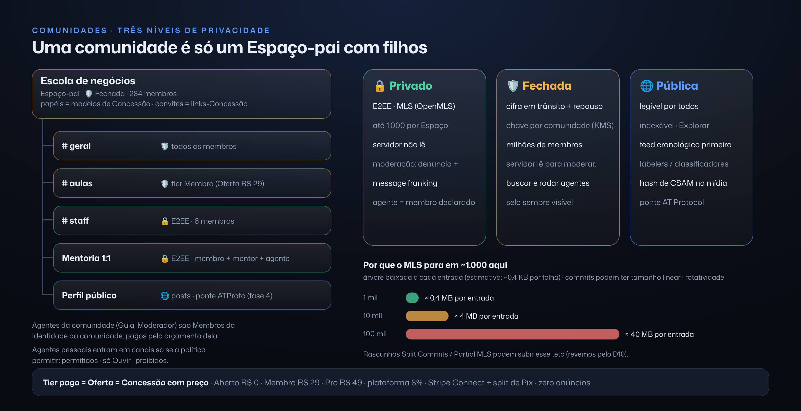

[Índice](../repensado.md) · [Anterior](05-escala-seguranca.md) · [Próximo](07-protocolos.md)

## 6. Comunidades (como construir)

**Uma comunidade é só um Espaço-pai** com Espaços-filhos (canais), papéis (modelos de Concessão), convites (Concessões em forma de link, com limite e prazo) e Ofertas (tiers). Não existe um objeto "comunidade" à parte.

### Três níveis de privacidade (visíveis no cabeçalho)
| Nível | Para quê | Cifra | Limite | Selo |
|---|---|---|---|---|
| **Privado** | DMs, grupos e canais de staff | E2EE (MLS) | até **1.000** membros por Espaço | 🔒 Ponta a ponta |
| **Fechada** | Comunidade com membros aprovados, cursos e tiers pagos | Em trânsito + em repouso (chave por comunidade no KMS). **O servidor pode ler para moderar, buscar e rodar agentes da comunidade** | milhões | 🛡️ Fechada |
| **Pública** | Perfis, posts e comunidades abertas | Legível por todos e indexável. Ponte AT Protocol na fase 4 | ilimitado | 🌐 Pública |

Uma comunidade 🛡️ pode ter canais 🔒 dentro dela (por exemplo, "staff" ou "mentoria 1:1"). O selo muda por canal, e a regra fica sempre à vista.

**Por que o MLS não vai para 100 mil membros**
- **Entrar exige baixar e validar a árvore inteira**, que cresce linearmente: com 100 mil folhas e credenciais, são dezenas de MB por entrada.
- Commits de remoção e atualização podem ter tamanho linear, e todo membro precisa processar todo commit. Com a rotatividade de uma comunidade grande (gente entrando e saindo o tempo todo), as épocas trocariam a cada segundo.
- Moderação, busca e descoberta exigem texto legível.
- O RFC/arquitetura do MLS mira grupos de milhares até dezenas de milhares. Os rascunhos *Split Commits* e *Partial MLS* reduzem custos, mas ainda não estão maduros (revemos pelo D10).

### Papéis, convites e regras
- **Papéis = modelos de Concessão:** Dono, Admin, Moderador, Membro, Convidado e Agente da comunidade.
- **Permissões por canal** herdam do pai, com exceções explícitas.
- **Convites:** um link é uma Concessão com limite de usos, prazo e tier, e pode exigir aprovação (o pedido cai em Atividade dos moderadores).
- **Política de agentes por canal:** "agentes de membros: permitidos · só Ouvir · proibidos".

### Moderação
- **Camadas:** papéis humanos, um **agente moderador** (Membro com Concessão de moderar, que age com desfazer), classificadores de texto e imagem (Hive ou OpenAI Moderation) e **hash de CSAM** (PhotoDNA/Cloudflare) em mídia 🛡️/🌐, com denúncias à SaferNet/NCMEC.
- **Recursos (apelação):** como toda remoção é versionada, ela é reversível. A apelação vira um pedido no Atividade dos moderadores, com prazo.
- **Transparência:** ações de moderação são eventos do log, visíveis como "Registro de moderação" da comunidade.
- **Em 🔒:** a moderação é por denúncia com message franking.

### Descoberta (Explorar)
- Categorias, busca (Postgres FTS → Typesense), "Crescendo" (crescimento relativo ao tamanho) e Destaques curados.
- Contra manipulação: idade da conta, grafo de convites e App Attest.

### Feed
- **v1:** cronológico, de quem você segue e das suas comunidades.
- **Depois:** "Para você" com motivos explicados ("porque você segue a Ana") e **feeds escolhíveis** (a ideia de feeds customizados do AT Protocol). Nada de otimizar só tempo de tela. **Zero anúncios.**

### Tiers pagos e repasses
- Uma **Oferta = Concessão-modelo com preço** (mensal, anual ou avulsa). A compra emite uma Concessão para a Identidade de quem comprou, e o acesso é só isso.
- **Repasse:** Stripe Connect (cartão, global) + PSP brasileiro com **split de Pix** (Pagar.me, Asaas ou similar) *(a verificar a disponibilidade de cada um)*.
- **Taxa da plataforma:** 8%. Exemplo canônico de tiers do criador: Aberto R$ 0 · Membro R$ 29 · Pro R$ 49.

### Agentes nas comunidades
- **Agentes da comunidade** (Guia, Moderador, Mentor) pertencem à Identidade da comunidade e gastam o orçamento dela. O tier define quanto desse orçamento cada membro usa.
- **Agentes pessoais** entram em canais só se a política do canal permitir.
- Em 🛡️ eles leem pelo servidor; em 🔒 são membros MLS declarados.

---

