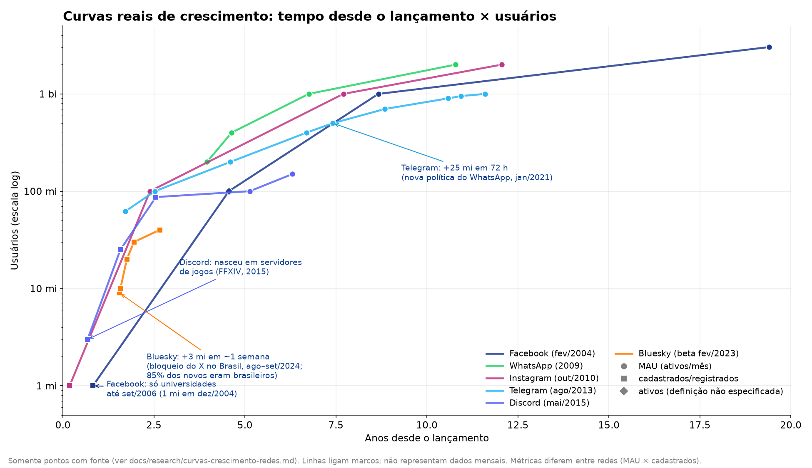
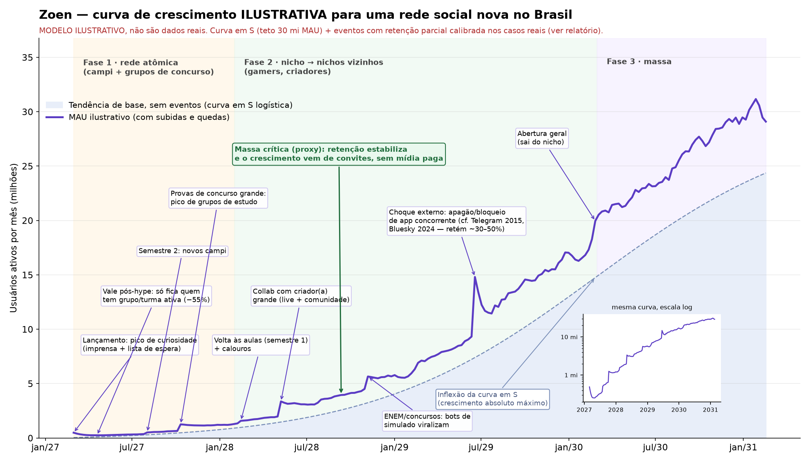

# Curvas de crescimento de redes sociais — o que funcionou, o que morreu, e o que isso diz para o Zoen

> Research snapshot. Figures, availability and source references retain their original review date. Current implementation and completion gates are in [roadmap status](../roadmap-status.md).

> Pesquisa feita em 09/10/2026 para orientar a estratégia de crescimento do Zoen no Brasil.
> **Regra deste documento:** todo número tem link de fonte. Quando não achamos fonte, está escrito **não encontrado**.
> "Massa crítica" e o "formato da curva" são **julgamentos nossos** a partir dos dados, e estão marcados como tal.
> As métricas variam entre redes: **MAU** = ativos no mês, **DAU** = ativos no dia, **cadastrados** = contas criadas e **alcance de anúncio** = público que a plataforma diz que um anunciante alcança (não é MAU).

*Figura 1: só pontos com fonte, com tempo normalizado desde o lançamento e escala log. As linhas ligam marcos; não são séries mensais.*

*Figura 2: **modelo ilustrativo, não são dados reais.** Explicação dos parâmetros na seção 4.*

---

## 0. Resumo em 11 linhas

[Read this chapter](curvas-crescimento-redes-0-resumo-em-11-linhas.md).

## 1. Redes de massa (as que venceram)

[Read this chapter](curvas-crescimento-redes-1-redes-de-massa-as-que-venceram.md).

## 2. Redes de nicho, de hype ou que estagnaram

[Read this chapter](curvas-crescimento-redes-2-redes-de-nicho-de-hype-ou-que-estagnaram.md).

## 3. O que as curvas ensinam (síntese)

[Read this chapter](curvas-crescimento-redes-3-o-que-as-curvas-ensinam-sintese.md).

## 4. Gráfico ilustrativo para o Zoen (Figura 2): parâmetros

[Read this chapter](curvas-crescimento-redes-4-grafico-ilustrativo-para-o-zoen-figura-2-parametros.md).

## 5. Começar de nicho é válido? Veredito e recomendação

[Read this chapter](curvas-crescimento-redes-5-comecar-de-nicho-e-valido-veredito-e-recomendacao.md).

## 6. "Pense nos gringos": lançamentos de nicho lá fora e travessia de fronteiras

[Read this chapter](curvas-crescimento-redes-6-pense-nos-gringos-lancamentos-de-nicho-la-fora-e-travessia.md).
