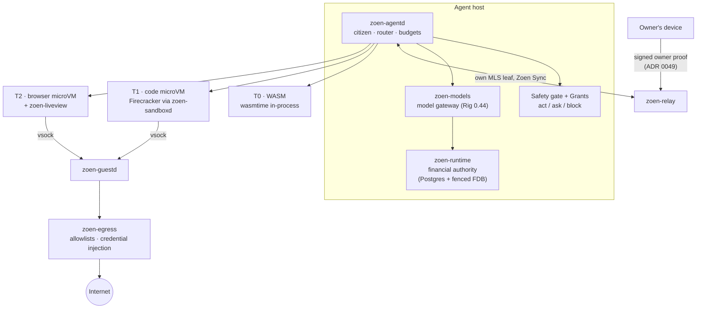

# Agents runtime & sandboxes

In Zoen an agent is a **first-class citizen**: it has its own identity and MLS device, a profile and avatar, Space memberships and invite links — exactly like a person. The difference is who holds its device: a runtime host keeps it on the relay while the owner is offline.

> **Status.** The citizen base, owner authorization, approvals, the Creator agent, agent links, the model gateway and the sandbox tiers exist on `main`. **Productive model execution is deliberately closed** until a certified core step, managed custody and restore continuity are in place. The capability-by-capability status is in the [agent runtime ledger](../agent-runtime-capabilities.md).



## The pieces

| Crate | Role |
| --- | --- |
| `crates/zoen-agentd` | The runtime. Agents as citizens (`citizen/`), the **Creator** agent, a router that picks the cheapest tier a tool's signed manifest allows, budgets, sessions and sandbox providers (`sandbox/`: fake, gVisor, Fly Machines). |
| `crates/zoen-models` | One Zoen-owned model-call boundary. Current profile: non-streaming OpenAI chat-completions over bounded HTTP using exactly **Rig 0.44.0**, with Rig types kept private. One transport attempt per admitted call — no silent retries. |
| `crates/zoen-runtime` | Postgres financial ledger and fenced FoundationDB dispatch admission. `run_model` stays closed until a genuine certified core step is loaded. |
| `crates/zoen-sandboxd` | Sandbox node agent: Firecracker microVMs under the jailer, template snapshots, a warm pool, cgroup limits. |
| `crates/zoen-guestd` | The agent inside each microVM: runs commands, moves files and forwards the only network path over vsock. |
| `crates/zoen-egress` | The only way out of a sandbox: per-tool allowlists, credential injection (the sandbox never sees passwords), approval cards for unlisted hosts, metadata-only logs. |
| `crates/zoen-liveview` | End-to-end encrypted live view of a browser microVM to its owner, with takeover for logins, 2FA or CAPTCHAs. |
| `crates/roda-gate` | Safety gate: hard rules first, then a typed decision; fails closed on irreversible actions. |

## How an agent comes to life

1. **Owner consent.** An agent profile must carry an `owner_proof`: the owner's enrolled device signs `zoen-agent-owner-v1 · OWNER · AGENT · DEVICE`. The relay checks it inside the registration transaction ([ADR 0049](../adr/0049-agent-owner-authorization.md)).
2. **Definition.** Persona, rules and free JSON state are **prompts**, not code. The Creator agent mints user agents from conversation and never hard-codes a vertical: a barber's agent and a dentist's differ only in their definition.
3. **Membership.** The agent joins Spaces through the normal membership flow and, in end-to-end Spaces, through its own MLS key packages. It reads only where it is a declared member.
4. **Sharing.** One stable agent link per agent opens a public page (`/a/CODE`) and a chat with the agent; links can be revoked, expire and have a use limit.

CLI equivalents (used by the journeys): `zoen agent-keys`, `zoen agent-init …`, `zoen authorize-agent AGENT_ID`, `zoen agent-host`, `zoen agent-pause|agent-resume|agent-revoke @AGENT`, `zoen agent CODE|HANDLE|LINK`.

## Approvals are durable

When an agent proposes something — a reply, a plan line, a mini-app, a payment — the proposal is stored **in full** in the request, bound by SHA-256 to its content, agent and Space. The owner's signed resolution is the receipt; the resulting item and its permission are derived from the original proposal, so approval cannot be swapped for something else, and a crash cannot leave an approved request without its effect ([ADR 0048](../adr/0048-durable-agent-approvals.md), [approvals API](../api-approvals.md)).

## Sandbox tiers

From [ADR 0028](../adr/0028-agent-sandbox.md): **cheapest by default, escalate only on declared need.**

| Tier | Runs | Isolation | Used for |
| --- | --- | --- | --- |
| **T0 · WASM** | In `zoen-agentd`, wasmtime with the pooling allocator | WASM capabilities, fuel, memory caps, grants | Hooks, transforms, parsers, API calls through host functions — most tools |
| **T1 · code microVM** | Firecracker on a sandbox node | Own guest kernel, jailer (chroot, cgroups v2, seccomp, own netns) | Shell, Python/Node, package installs, file conversion |
| **T2 · browser microVM** | Same as T1 from a browser template | Same as T1 | Browsing, forms, logins with a human handoff |

Rules: every tool ships a signed capability manifest; a model cannot request a heavier tier at runtime; escalation needs a grant, and anything beyond it becomes an approval. Sandboxes start lazily, suspend when idle and are torn down at the end of the task. Research behind the design: [agent sandbox](../research/agent-sandbox.md), [E2B notes](../research/e2b-sandbox.md).

## Testing the runtime

```sh
cargo test -p zoen-agentd                    # citizen, WASM, sandbox journeys (some need gVisor/Firecracker)
cargo test -p zoen-models                    # gateway: provider, dispatch, privacy
# Real-model smoke (not a CI test): the Creator builds a barber's booking bot, then the bot answers a client
CLOUDFLARE_WORKERS_AI_TOKEN=… CLOUDFLARE_ACCOUNT_ID=… cargo run -p zoen-agentd --example creator_smoke
```

CI installs gVisor and Firecracker so the sandbox journeys run for real ([testing & CI](testing-and-ci.md)).
