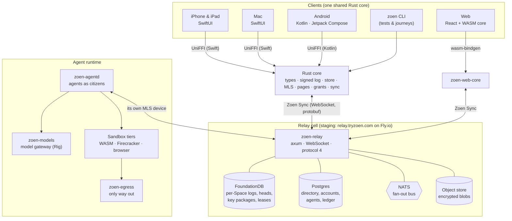
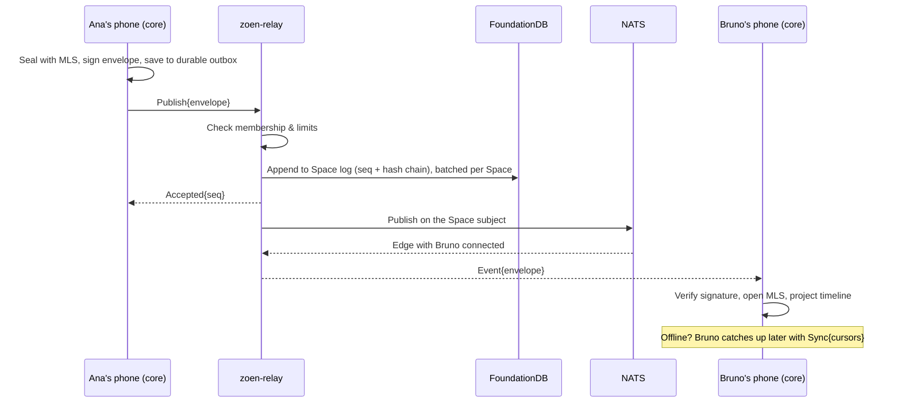

# Architecture overview

Zoen is **one Rust core** shared by every client, a **relay** that orders and fans out signed (and usually encrypted) events, and an **agent runtime** that lets agents join conversations as real members.

## The three ideas that shape everything

### 1. Every conversation is a signed log

A conversation — a **Space** — is an append-only log of events. Authors sign their own bytes (Ed25519); the relay chains them by hash and assigns order, but never rewrites them ([ADR 0010](../adr/0010-binary-protocol.md)). Messages, edits, reactions, page versions, mini-app actions and approvals are all events. Every client rebuilds the same state by replaying the same log, which is why iPhone, Android, web and the CLI behave identically.

### 2. The relay is deliberately small

`zoen-relay` does three things: **orders** each Space's log in FoundationDB, **stores** signed envelopes verbatim (ciphertext in end-to-end Spaces), and **fans out** events and ephemeral signals to online members. Offline devices catch up by cursor. Membership is the only thing it must understand, because it decides who may write and who receives. See [Relay & server](relay.md).

### 3. Agents follow the same rules as people

An agent has its own identity and device key, joins a Space through the same membership flow, and reads end-to-end content only as a declared member. Sensitive actions go through durable approval cards signed by the owner. See [Agents runtime & sandboxes](agents.md).

## Where code lives

| Layer | Path | Read more |
| --- | --- | --- |
| Shared core | `crates/roda-*` (types, log, store, mls, docs, grants, gate, proto, ffi) | [Rust core](rust-core.md) |
| Browser core | `crates/zoen-web-core`, `packages/zoen-ui/web` | [Clients](clients.md#web) |
| Relay | `crates/zoen-relay` | [Relay & server](relay.md) |
| Agents | `crates/zoen-agentd`, `zoen-models`, `zoen-runtime`, `zoen-sandboxd`, `zoen-guestd`, `zoen-egress`, `zoen-liveview` | [Agents](agents.md) |
| Apple | `apple/` (XcodeGen `project.yml`) | [Clients](clients.md#apple) |
| Android | `android/` | [Clients](clients.md#android) |
| Mini-apps | `miniapps/`, `packages/zoen-miniapp-sdk`, `tools/miniapp-build` | [Mini-apps](mini-apps.md) |
| Infrastructure | `infra/` (Fly, Kubernetes, OpenTofu, FDB, k3d) | [Relay & server](relay.md#deployment) |

> Some crates still carry a legacy prefix in their directory and package names. The product name is Zoen everywhere; the rename is a tracked, atomic cutover ([naming](../dev/naming.md)).

## A message, end to end

## Design records

Every significant choice has an Architecture Decision Record in [`docs/adr/`](../adr/). Start with:

- [0008 FoundationDB as system of record](../adr/0008-foundationdb-system-of-record.md) · [0009 Fan-out logs, not inboxes](../adr/0009-fanout-logs-not-inboxes.md) · [0010 Binary protocol](../adr/0010-binary-protocol.md)
- [0026 End-to-end Spaces on OpenMLS](../adr/0026-e2e-spaces-on-openmls.md) · [0027 End-to-end by default](../adr/0027-end-to-end-by-default.md)
- [0028 Agent sandboxes](../adr/0028-agent-sandbox.md) · [0042 Dynamic UI](../adr/0042-dynamic-ui.md)

The longer-form [system design](../system-design.md), [security model](../security.md) and [scale review](../scale-review.md) go deeper.
