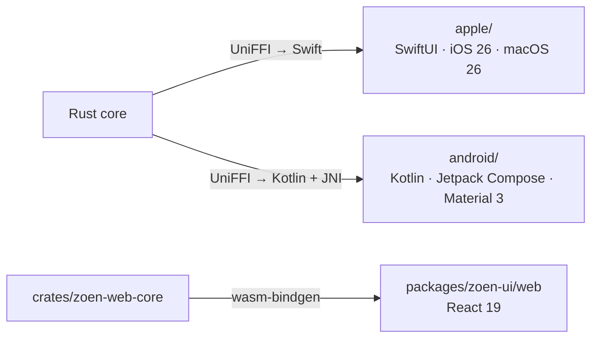
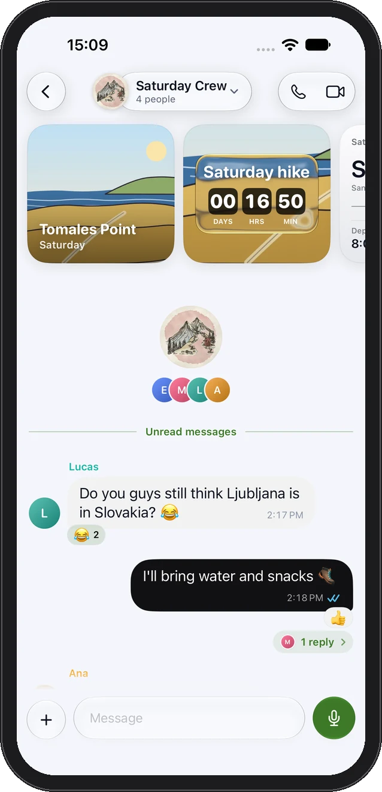
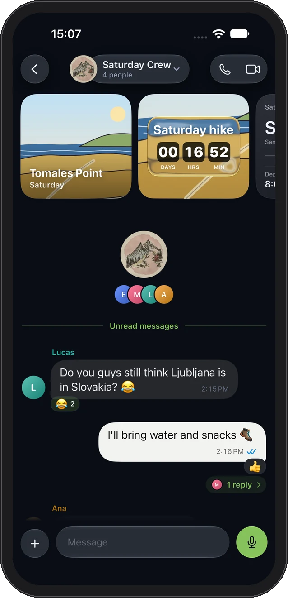

# Clients

Every client renders the **same core**. Apple and Android link the Rust engine through UniFFI; the web client runs the protocol and MLS client compiled to WebAssembly. No client keeps its own copy of the messaging logic, its own database schema or a mock messaging service.



## Design principles shared by all clients

- **Native first**: platform navigation, typography, accessibility settings and gestures; the web follows the iOS themes and conversation hierarchy.
- **One Chats list** for direct chats, groups and communities, with optional filters.
- **Cards for things that need you**: approvals, notifications and plans are cards; you can switch to a list and back.
- **Plain language**: no technical jargon in the UI.
- **Accessibility**: Reduce Motion, Reduce Transparency and Increase Contrast are honoured and checked ([HIG matrix](../product/hig-compliance.md), [motion](../ux-motion.md)).

## Apple

| | |
| --- | --- |
| Path | `apple/` — `Shared/` (features, design system, navigation, sync, widgets), `iOS/`, `Mac/`, `Tests/`, `UITests/` |
| Project | Generated by **XcodeGen** from `apple/project.yml` (targets `ZoeniOS`, `ZoenMac`, `ZoenUITests`, `Zoen-Device`) |
| Language | Swift 6, SwiftUI; deployment targets iOS 26 and macOS 26 |
| Core | XCFramework + Swift bindings built by `scripts/build-core.sh` into `apple/Packages/` |
| Look | Glass cards and buttons from a custom Metal shader (`apple/Shared/DesignSystem/ZoenGlass.metal`) on `main`; a move to system Liquid Glass is on the `ui/native-glass` branch |
| On-device model | Foundation Models chooses mini-apps when available, with keyword fallback |

Run it:

```sh
scripts/run.sh            # builds the core if missing, generates the Xcode project, opens iOS simulator + Mac
scripts/run.sh ios        # iOS only
scripts/run.sh mac        # Mac only
SIM="iPhone 17 Pro" scripts/run.sh ios
scripts/build-core.sh     # rebuild the XCFramework and Swift bindings after any core API change
```

More: [watch mode](../../scripts/watch.sh) rebuilds and relaunches on every change; [installing on an iPhone](../dev/instalar-no-iphone.md) (`scripts/device.sh`); [the iPhone app on a Mac](../dev/iphone-no-mac.md) (`scripts/mac-iphone.sh`).

 

## Android

| | |
| --- | --- |
| Path | `android/` (Gradle, `app/` module, package `xyz.tironi.zoen`) |
| Language | Kotlin, Jetpack Compose, **Material 3** |
| Requirements | JDK 17, Android SDK 36, build-tools 36.0.0, NDK 27.1.12297006, `cargo-ndk`; runs on Android 9+ (ARM64 phones, x86_64 emulators) |
| Core | A Gradle task compiles the Rust library and generates matching Kotlin bindings before Kotlin compilation |
| Navigation | Bottom bar on compact windows, rail from 600 dp, list/detail panes from 840 dp; predictive Back |
| Keys | AES-256-GCM wrapped secrets in no-backup storage under a non-exportable Android Keystore key |
| Mini-apps | Native mini-apps on every supported version; the HTML MCP host needs a WebView with `WEB_MESSAGE_LISTENER` and `MULTI_PROFILE` |

Run it:

```sh
cargo install cargo-ndk --locked
rustup target add aarch64-linux-android x86_64-linux-android
export ANDROID_HOME=/path/to/android/sdk
scripts/run-android.sh -PandroidAbis=arm64-v8a   # build, install, launch on a connected device
```

Or from `android/`: `./gradlew :app:assembleDebug`, `./gradlew :app:testDebugUnitTest :app:lintDebug`, `./gradlew :app:connectedDebugAndroidTest`. Debug builds have an explicit **Explore the demo** entry with clearly labelled simulated peers. Full details: [android/README.md](../../android/README.md), [parity record](../dev/android-parity.md).

## Web

Two entry points live in `packages/zoen-ui`:

| Entry | What it is |
| --- | --- |
| **Shell preview** (`preview/`) | The reusable React application shell with sample data — for layout and interaction review. No message delivery. |
| **Authenticated browser client** (`web/`) | Real client: paired by the phone, native protocol 4, OpenMLS in a dedicated worker, signing through a non-exportable WebCrypto key, encrypted IndexedDB session. |

```sh
# Shell preview (sample data) → http://127.0.0.1:4173
npm ci --prefix packages/zoen-ui --ignore-scripts
npm run preview --prefix packages/zoen-ui

# Authenticated client → http://127.0.0.1:4174
cd packages/zoen-ui
npm ci
npm run typecheck:web && npm run test:web
ZOEN_WASM_BINDGEN=/absolute/path/to/wasm-bindgen npm run build:web
npm run web
```

The build needs the `wasm32-unknown-unknown` target and wasm-bindgen CLI 0.2.129. Output is pinned with SRI hashes; the server sets COOP/COEP isolation. Real native/browser pairing and reload/reconnect journeys are still open. Details: [web client README](../../packages/zoen-ui/web/README.md), [ADR 0029](../adr/0029-web-app.md).

## The zoen CLI

`crates/zoen-cli` builds the `zoen` binary: **a person at a terminal, using the exact core the apps use**. Every command is a fresh process — open the database, load the key, connect, catch up, act, flush, exit. It powers the end-to-end journeys in CI and is the fastest way to explore the system ([tutorial](../guides/run-locally.md)).
