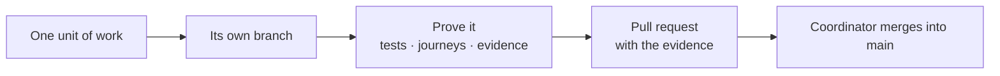

# Contributing & merge rules

> **License first.** Zoen is **proprietary**: the repository is public for viewing only. Using, copying, modifying or distributing it needs prior written permission from Enzo Tironi ([LICENSE](../../LICENSE)). The rules below apply to people and agents working on Zoen with that permission.

## How work flows



1. **One branch per unit.** Each coherent change lives on its own branch and is merged into `main` by the **coordinator** only after the unit's proof, following the pstack playbooks ([prelaunch policy](../dev/prelaunch-policy.md)).
2. **Prove, don't promise.** Every change is verified with the checks that fit it: type checks, lint, unit and integration tests, end-to-end journeys, builds. Tests verify intended behaviour; never weaken a test to make a change pass ([testing & CI](testing-and-ci.md)).
3. **Evidence belongs to a revision.** An earlier green run doesn't certify changed source. Record what was run, on which commit, and what it does *not* cover.
4. **Never rewrite shared history.** No force-pushes to shared branches; preserve other people's and agents' work. Don't move files someone else is actively editing.
5. **Don't disable CI** without explicit authorization.

> The [shared-main workflow](../dev/shared-main-workflow.md) describes only the 12 October checkpoint; current work uses branches as above.

## Prelaunch policy

Zoen v2 has no production users or data yet, so:

- **No compatibility shims**, legacy aliases, dual reads/writes or backfills unless explicitly requested.
- **Internal interfaces aren't contracts**: change them together with every caller and test.
- **Development data is disposable**: reset affected databases instead of adding complexity to keep them.
- **Correctness still rules**: database invariants, transactional safety, migration idempotence and deterministic setup are non-negotiable.

## Product rules every change must respect

- **No technical jargon in the UI.** People see "Approve", "Link a device", "Your agent needs you" — never keys, epochs, relays or protocol words.
- **Use the name Zoen** for the product and the built-in agent. Legacy identifiers in code are removed through the coordinated [naming cutover](../dev/naming.md), not piecemeal.
- **Privacy only goes up.** Never add a path that makes an end-to-end conversation readable by the server.
- **Agents ask before acting** on anything sensitive, through durable approvals.
- **Demo data stays behind a dev flag** and is visibly labelled.
- **Accessibility is part of done**: VoiceOver/TalkBack, keyboard, Dynamic Type, Reduce Motion/Transparency ([HIG matrix](../product/hig-compliance.md)).

## Before you open a pull request

```sh
export RUSTUP_TOOLCHAIN=1.99.0
cargo fmt --all --check
cargo clippy --workspace --all-targets -- -D warnings
cargo test -p <crate-you-touched>
```

Plus, as relevant: regenerate bindings after core API changes (`scripts/build-core.sh`, `scripts/build-android-core.sh`), run the web checks (`npm run test:web`), the Android unit tests and lint, and the journeys that cover your change.

## Writing docs

- Ground every statement in code, an ADR or recorded evidence. **Never invent features, numbers or metrics.**
- Mark anything not on `main` as **planned** or **in progress**.
- Product docs live in `docs/product/`, engineering explanation in `docs/technical/`, tutorials and how-to guides in `docs/guides/`, reference in `docs/reference/`. The docs site in `docs-site/` builds from these files — edit the Markdown, not the generated site pages.
- Significant decisions get an ADR in `docs/adr/`.
- Every Markdown file under `docs/` is also imported by the `journey_files` test corpus ([why](testing-and-ci.md#markdown-import-performance)).
