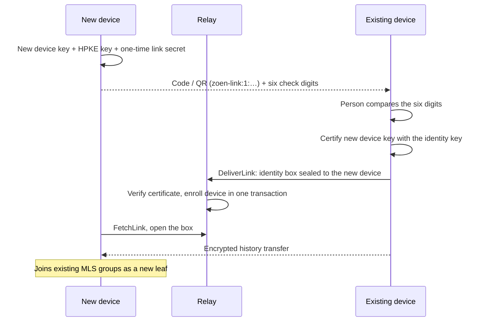

# Encryption & devices

Zoen's privacy model in one sentence: **the relay orders and delivers ciphertext it cannot read, every device holds its own keys, and an account can survive the loss of every device.**

The full threat model (assets, adversaries, STRIDE per component) is in [security](../security.md). This page explains the parts you'll touch as an engineer.

## Identity and device keys

- An **account** is one Ed25519 **identity key**. There are no passwords for signing in ([ADR 0003](../adr/0003-identity-and-device-keys.md)).
- Each phone, computer, browser or agent runtime has its own **device key**, certified by the identity key. Keys are stored in the platform keystore (Keychain on Apple; non-exportable WebCrypto in the browser).
- Hardware-bound wrapping (Secure Enclave) and a passkey-protected identity root are **planned**.

## End-to-end Spaces on MLS

Direct chats and new groups are **end-to-end by default** ([ADR 0027](../adr/0027-end-to-end-by-default.md)), built on **OpenMLS** (RFC 9420) ([ADR 0026](../adr/0026-e2e-spaces-on-openmls.md)).

| Property | How |
| --- | --- |
| Ciphersuite | `MLS_128_DHKEMX25519_CHACHA20POLY1305_SHA256_Ed25519` (0x0003). The suite travels with every sealed payload, so groups can upgrade (a post-quantum suite is behind a flag pending its final code point). |
| Members | Every **device** is an MLS leaf; its signature key is the device's Ed25519 key, so there is no second key system. |
| What the relay sees | Ordering, membership (to authorize writes and fan-out) and ciphertext. Never message text. |
| Forks and lies | MLS protects content, not the shape of the log. Member-signed checkpoints and the hash chain let clients detect a relay that shows different histories to different members. |
| Privacy only goes up | A relay-readable chat can be converted to end-to-end (`zoen encrypt CHAT`), never the reverse. |
| Communities | Stay relay-readable on purpose: open to join, moderated, served by server-side tools, and beyond MLS's practical group size. |
| Agents | Read an end-to-end Space **only** as a roster member with their own certified MLS leaf. The relay never receives a reading key. |

Other sealed data:

- **Media** — per-file random keys with XChaCha20-Poly1305, uploaded as content-addressed blobs ([ADR 0007](../adr/0007-encrypted-media-blobs.md)).
- **Profiles** — name, bio and photo sealed under a per-person profile key, shared with contacts inside signed Space events ([ADR 0016](../adr/0016-encrypted-profiles.md)).
- **Padding** — sealed payloads pad to size buckets.

## Linking a device

Signal-style linking with **full history** ([ADR 0045](../adr/0045-linking-devices.md)):



Try it from two terminals with the CLI (against a local relay):

```sh
zoen --home /tmp/ana-laptop link-request   # prints a code and check digits
zoen --home /tmp/ana link CODE             # on the existing device
zoen --home /tmp/ana devices               # list devices; `unlink DEVICE` to revoke
```

Revoking a device removes its relay authorization and its MLS leaf: it reads nothing after removal.

## Backup and the recovery key

Optional, **off by default**, end-to-end encrypted ([ADR 0046](../adr/0046-encrypted-backup.md)).

- **What's inside:** identity and agreement secrets plus a trimmed copy of the device database (events, profiles, keys to already-uploaded media). Old-device MLS state, the outbox and search index are excluded.
- **Sealing:** a random 32-byte key encrypts the payload with XChaCha20-Poly1305.
- **Recovery key:** 64 random decimal digits, shown in groups of four, about 212 bits of entropy. The relay stores only a verifier and the wrapped key — no server trust needed.
- **Password mode:** an OPRF vault with Argon2id stretching (64 MiB) and a guess limit. **Off by default; not ready for public activation** until an identity-bound recovery authority exists.

```sh
zoen --home /tmp/ana backup on --recovery-key
zoen --home /tmp/ana backup status
zoen --home /tmp/new recover @ana --recovery-key "KEY"   # a new device from the backup
```

## Recovery without any surviving device

Restoring a backup creates a fresh device but cannot rejoin MLS groups by itself if every old device is gone. Zoen uses **MLS external commits** (RFC 9420 §12.4.3): each commit publishes the next epoch's GroupInfo as an encrypted blob, so a restored device can rejoin from authenticated public state ([ADR 0047](../adr/0047-mls-peerless-recovery.md)). This is implemented for development; production gates remain open.

## Open gates

From the [roadmap status](../roadmap-status.md#deployment-and-capacity): native recovery and device controls on every platform, production backup authority (OPRF counters across nodes, proof of key destruction), key transparency, sealed-sender delivery and message franking for moderation.
