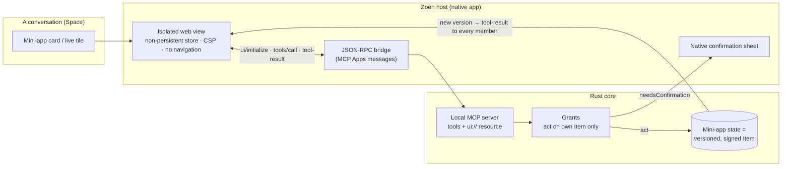

# Mini-apps (MCP Apps)

A Zoen mini-app is a small app that opens **inside a conversation**. Zoen implements the host side of **MCP Apps** (SEP-1865, version `2026-01-26`): a mini-app is an MCP server with **tools** plus an **HTML UI resource**, rendered in an isolated web view, talking to the host over JSON-RPC. Because it's the open standard, the same bundle can also run in other MCP hosts.



## How it works

1. **The mini-app declares itself.** A resource with MIME `text/html;profile=mcp-app` and tools carrying `_meta.ui.resourceUri` and a `visibility` (`model` — the agent can call it; `app` — the UI can call it). The host **refuses** `tools/call` from the UI for tools without `app`.
2. **Handshake.** `ui/initialize` with `protocolVersion`, `hostInfo` and `hostCapabilities`; the `hostContext` carries theme, styles, display mode, container size, locale, time zone, platform, device capabilities and safe-area insets. Then `ui/notifications/initialized` → `tool-input` → `tool-result`.
3. **State is an Item.** Every tap that changes something becomes a **signed version** of the mini-app's Item in the Space log. Everyone sees the same state and who did what; the agent can comment on what matters.
4. **Grants decide.** Every `tools/call` goes through the Grants evaluator. A mini-app may act **only on its own Item**. Irreversible or external tools return `needsConfirmation` and run only after the **native** confirmation sheet — the mini-app cannot draw that button.
5. **Sandboxed.** The spec's default CSP is injected (`default-src 'none'`, `connect-src 'none'`, `frame-src 'none'`…), each card gets a non-persistent website data store, and navigation and new windows are blocked. Network is closed unless the manifest declares a domain **and** the person allowed it.

Full message list and the honest list of deviations (local server inside the core, a WebKit message-handler transport instead of `window.parent.postMessage`, `tool-result` re-sent per version for live state): [mini-apps reference](../mini-apps.md). The forward-looking design for dynamic UI everywhere: [ADR 0042](../adr/0042-dynamic-ui.md).

## Repository layout

| Path | What |
| --- | --- |
| `miniapps/<id>/` | A mini-app: `manifest.json` + `src/` (React or plain HTML). Today: `hike`, `schedule`. |
| `packages/zoen-miniapp-sdk` | `@zoen/miniapp-sdk` — zero-dependency bridge: `zoen.state`, `zoen.members`, `zoen.ai`, `zoen.haptics`, `zoen.widget`, `zoen.theme`, `zoen.native.*`, `zoen.capabilities.has()`. |
| `packages/zoen-ui` | `@zoen/ui` — React components and `tokens.css` for mini-apps. |
| `tools/miniapp-build` | Builds one mini-app into **one offline, hash-pinned HTML file** plus a manifest with its SHA-256. |
| `tools/miniapp-gen` | Headless render of a built mini-app for screenshots and console errors. |
| `crates/roda-ffi/src/apps.rs` | The local MCP server: app specs, tools, resources and state rules. |
| `crates/roda-ffi/src/apps/schedule.rs` | Agenda's rules: no overlaps, opening hours in the business time zone, per-member caps, per-viewer filtering. |
| `crates/roda-ffi/apps/` | Built bundles embedded into the core. |

## The manifest

`tools/miniapp-build/build.mjs` validates it strictly — a bundle that breaks a rule is not written:

```json
{
  "id": "schedule",
  "name": "Agenda",
  "description": "Horários livres, serviços e preços. O cliente marca; o agente confirma o que for especial.",
  "entry": "src/main.tsx",
  "capabilities": [
    { "id": "calendar.add", "purpose": "Colocar o horário marcado na sua agenda. Você vê o evento antes de salvar." }
  ],
  "allowedDomains": [],
  "linkDomains": [],
  "maxKB": 400
}
```

Field-by-field rules are in the [manifest reference](../reference/miniapp-manifest.md).

## Built-in mini-apps

| Mini-app | UI | Shared state |
| --- | --- | --- |
| **Agenda** (`schedule`) | HTML (React) | Services, weekly hours, bookings, events to resolve; clients see busy times only |
| **Saturday hike** (`hike`) | HTML (React + MapLibre, offline SVG fallback) | Trails, votes, photos |
| **Poll** | HTML | Votes; the winner becomes a line in the chat's plan |
| **Group list** | HTML | Items and who checked them |
| **Group pet** | Native (plus an HTML view for other hosts) | Food, mood, rest, name, mini-game leaderboard |
| **MapTap** | Native | Five daily places, guesses and points per person |
| **Dinner** | Native | Servings, checked ingredients, current step |
| **Countdown** | Native | The group's countdown |

## Not yet

- **Remote MCP servers** (stdio/HTTP), third-party discovery and the **Store/catalog** are planned.
- External sends in demos (e.g. "Send on WhatsApp") are simulated and labelled as such.

Next: [build your first mini-app](../guides/first-mini-app.md).
