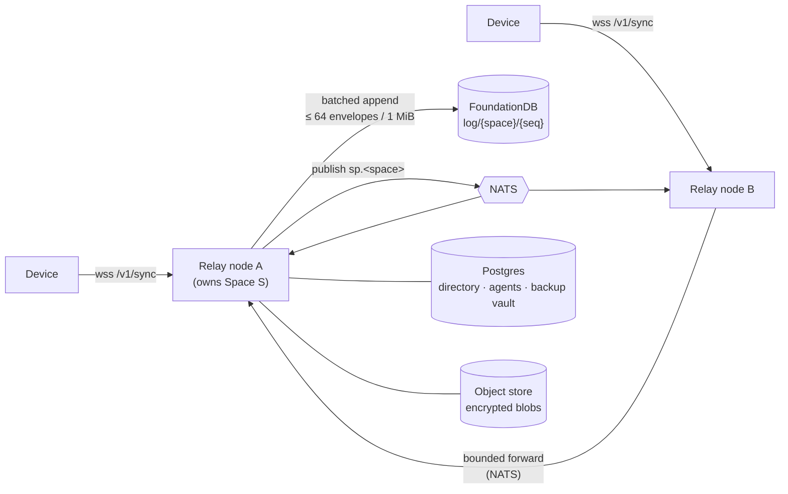

# Relay & server

`zoen-relay` is the Zoen Sync server: a Rust service on **axum** that speaks the binary sync protocol over WebSocket, stores per-Space logs in **FoundationDB**, keeps the directory in **Postgres**, fans out through **NATS** and stores encrypted blobs in an object store.

It does three things and nothing else:

1. **Orders** — each Space has one append-only log; one transaction assigns the sequence number and chains the hash ([ADR 0008](../adr/0008-foundationdb-system-of-record.md)).
2. **Stores** — signed envelopes, verbatim. In end-to-end Spaces, that's ciphertext.
3. **Fans out** — sequenced events and ephemeral signals (typing, presence) to online members; everyone else catches up with `Sync` on reconnect ([ADR 0009](../adr/0009-fanout-logs-not-inboxes.md)).



## Building blocks

| Concern | How it works | Record |
| --- | --- | --- |
| Wire protocol | Protobuf frames over one WebSocket per device; **protocol 4**. Hello → Challenge → Auth → Ready → Sync → Publish/Event. | [ADR 0010](../adr/0010-binary-protocol.md) |
| Ordering | The relay that owns a Space orders appends in memory, one queue and worker per active Space, committing batches of up to 64 envelopes or 1 MiB. | [ADR 0023](../adr/0023-per-space-sequencer.md) |
| Ownership | Renewable ownership leases persisted in FoundationDB; fencing tokens checked inside append transactions. | [ADR 0018](../adr/0018-space-ownership.md) |
| Cross-node | Bounded NATS forwarding to the owner; subjects carry keyed pseudonyms, never identities. | [ADR 0019](../adr/0019-fanout-bus.md) |
| Abuse | GCRA rate buckets that outlive sessions, per device and per client address. | [ADR 0020](../adr/0020-abuse-controls.md) |
| Telemetry | Traces and logs with **no content and no clear identifiers**. | [ADR 0021](../adr/0021-telemetry.md) |
| Metrics | Product metrics without content. | [ADR 0043](../adr/0043-product-metrics.md) |
| Key packages | MLS key-package claims with retries and receipts. | [key-package claims](../key-package-claim-retries.md) |

## HTTP surface

Besides the WebSocket at `/v1/sync`, the relay serves (from `crates/zoen-relay/src/lib.rs`):

| Route | Purpose |
| --- | --- |
| `/healthz`, `/readyz` | Liveness and readiness. |
| `/v1/blobs/{sha}` | Encrypted, content-addressed media. |
| `/v1/transfer/{id}`, `/v1/transfer/{id}/{n}` | Encrypted history transfer between linked devices. |
| `/v1/backup/…` | Encrypted backup: blob, vault, OPRF and restore steps. |
| `/v1/config`, `/v1/report` | Remote config and content-free reports. |
| `/a/{target}`, `/install` | Public agent-link page and install redirect. |
| `/.well-known/apple-app-site-association`, `/.well-known/assetlinks.json` | Universal/App Links. |
| `/admin`, `/admin/config`, `/admin/metrics` | Operator pages (token-protected). |

## Running it locally

One command brings up a private FoundationDB, a private Postgres and the relay on port 8787:

```sh
scripts/dev-stack.sh                                  # stays attached to the relay
DATABASE_URL=postgres://user@host/db scripts/dev-stack.sh   # or use your own Postgres
```

Debug builds of the iOS simulator and Mac app connect to `127.0.0.1:8787` by default; the Android emulator reaches it at `http://10.0.2.2:8787`.

For a Kubernetes cell on your machine (k3d):

```sh
scripts/local-cluster.sh up
scripts/local-cluster.sh journey
scripts/local-cluster.sh down
```

## Deployment

**Staging** runs on Fly.io in São Paulo (`gru`), with Cloudflare as the edge only ([ADR 0015](../adr/0015-staging-on-fly-behind-cloudflare.md)). Hostnames: `relay.tryzoen.com`, `api.tryzoen.com`, `media.tryzoen.com`, `id.tryzoen.com` (`infra/fly/relay.toml`).

```sh
infra/fly/deploy.sh                          # idempotent: creates what's missing, then deploys
cd infra/tofu/envs/staging && tofu apply     # Cloudflare edge as code
scripts/journey-remote.sh https://relay.tryzoen.com
```

Production is designed as Kubernetes cells managed with OpenTofu and GitOps (`infra/k8s`, `infra/tofu`; [ADR 0012](../adr/0012-infrastructure-as-code.md), [infrastructure](../infra.md)).

> **Compatibility note.** Current clients require **protocol 4**. Staging was last observed advertising protocol 2, so verify negotiation before a current-client journey against it ([Android relay release](../dev/android-relay-release.md)). For development, run a same-source relay locally.

## Capacity, honestly

The scale model (one billion monthly users) is a set of **design inputs**. Development-box measurements are recorded in [ADR 0022](../adr/0022-capacity.md), [ADR 0023](../adr/0023-per-space-sequencer.md), the [relay scale audit](../relay-scale-audit.md) and the [scale review](../scale-review.md). Sustained TLS throughput, failover, region loss and total cost still require representative deployment drills.
