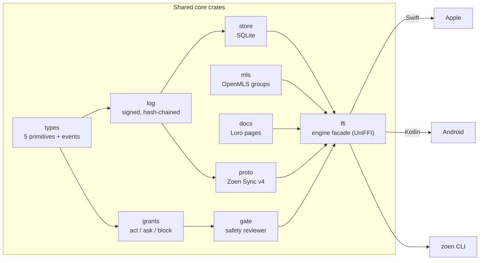
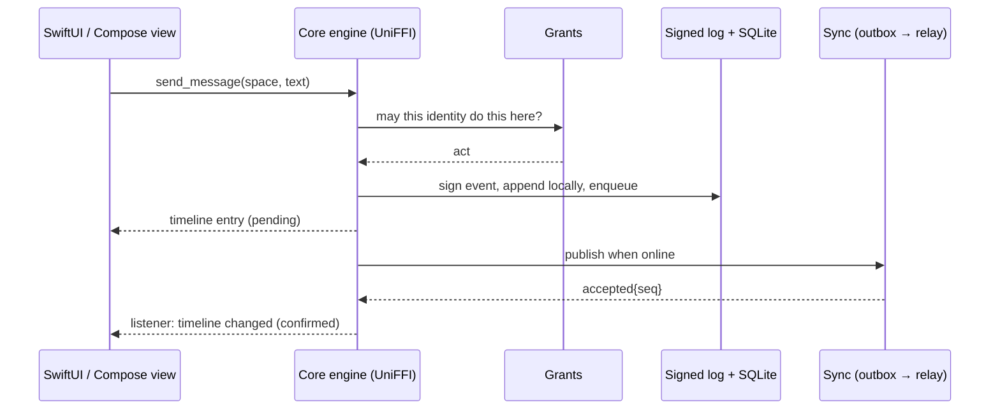

# Rust core

The core is where Zoen's behaviour lives: identities and devices, the signed event log, local storage, end-to-end encryption, pages, permissions and sync. Clients are thin — they render projections the core hands them and send intents back.



## Crates

| Crate (path) | Responsibility |
| --- | --- |
| `crates/roda-types` | The **five primitives** — Identity, Space, Member, Item, Grant — and every event body in the log. |
| `crates/roda-log` | One append-only log per Space, **signed with Ed25519 and chained with SHA-256**. |
| `crates/roda-store` | Local storage on SQLite (bundled `rusqlite`), with a seam reserved for SQLCipher. |
| `crates/roda-mls` | End-to-end Spaces on **OpenMLS**: one device is one MLS leaf, signing with the device's Ed25519 key ([ADR 0026](../adr/0026-e2e-spaces-on-openmls.md)). |
| `crates/roda-docs` | Pages as **Loro** block documents; Markdown is only an import/export format, and untouched blocks round-trip byte-identical ([ADR 0040](../adr/0040-files-viewers-editors.md)). |
| `crates/roda-grants` | Pure trust model (no I/O): trust levels, budgets and the **act / ask / block** decision. |
| `crates/roda-gate` | Safety gate: hard rules first, then one typed decision call, mapped to allow / ask / block; fails closed on irreversible actions; audit records go to the Space log. |
| `crates/roda-proto` | **Zoen Sync**, the wire protocol (version 4): envelopes, frames and their verification, shared by relay, core and agents. |
| `crates/roda-ffi` | The engine facade exposed to Swift and Kotlin through **UniFFI**: accounts, chats, sync, MLS, linking, backup, files, pages, mini-apps, approvals and the certified agent runtime core. |
| `crates/zoen-web-core` | The browser adapter: same protocol and MLS client, compiled to WebAssembly. Device signing keys stay in non-exportable WebCrypto, never in Rust. |
| `tools/uniffi-bindgen` | The pinned UniFFI binding generator used by the Apple and Android builds. |

> Directory names with a legacy prefix are pending the [naming cutover](../dev/naming.md).

## How a client talks to the core

The facade is a **small, synchronous API**: the app calls the engine; the engine evaluates grants, signs, stores and returns view models ready for the UI. Change notifications arrive through a listener callback, which the Swift and Kotlin layers turn into their own async streams/flows.



## Building the core

Apple (XCFramework + Swift bindings, on macOS with Xcode):

```sh
rustup toolchain install 1.99.0 --profile minimal --component rustfmt,clippy
export RUSTUP_TOOLCHAIN=1.99.0
rustup target add aarch64-apple-ios aarch64-apple-ios-sim aarch64-apple-darwin
scripts/build-core.sh              # always rebuild
scripts/build-core.sh --if-stale   # only when core sources are newer than the package
```

Android (native libraries + Kotlin bindings from the same build):

```sh
cargo install cargo-ndk --locked
rustup target add aarch64-linux-android x86_64-linux-android
scripts/build-android-core.sh --debug --abis=arm64-v8a,x86_64
```

The Gradle build also runs this step for you before compiling Kotlin. **Always regenerate bindings together with the native library** — a mismatched pair is not a valid build.

## Performance notes

`Cargo.toml` raises `opt-level` to 3 for crypto, serialization, Loro and the core crates even in debug builds: backup passwords stretch with Argon2id (64 MiB), and imports build Loro pages, decode the durable queue and seal MLS messages. Debug assertions and overflow checks keep their development defaults.

## Rules for changing the core

- **Signed bytes are sacred.** Envelopes are the author's exact signed bytes; nobody re-encodes them ([ADR 0010](../adr/0010-binary-protocol.md)).
- **Storage behind traits** so backends can change without touching callers ([ADR 0011](../adr/0011-storage-seams.md)).
- **Sortable IDs** (ULIDs) everywhere ([ADR 0017](../adr/0017-sortable-ids.md)).
- **No compatibility shims before launch.** Update interfaces and all callers and tests together ([prelaunch policy](../dev/prelaunch-policy.md)).
