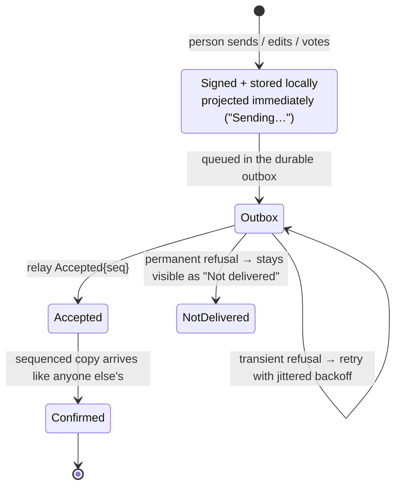

# Sync

Zoen is **offline-first**: writes never wait for the network, every device keeps its own durable copy of each conversation, and reconnecting is just "send what I have, fetch what I'm missing".

## The model



| Mechanism | Detail | Record |
| --- | --- | --- |
| **Durable outbox** | A write is signed, stored in the outbox table and projected at once. The core's network task flushes it after login and whenever poked. | [ADR 0004](../adr/0004-offline-first-outbox.md) |
| **Idempotency** | Each write carries a `client_id`; killing the app mid-send and resending is harmless. | ADR 0004 |
| **Backoff** | Jittered retry between 0.5 s and 30 s spreads reconnect storms. | ADR 0004 |
| **Catch-up** | Per-Space cursors (`next_seq`). The relay pages history and ends with `SyncDone`; one read batch answers "which of my Spaces moved". | [ADR 0009](../adr/0009-fanout-logs-not-inboxes.md) |
| **Gaps** | Sequence numbers are dense per Space; an out-of-order arrival triggers a targeted sync. | [ADR 0008](../adr/0008-foundationdb-system-of-record.md) |
| **Ephemeral signals** | Typing, status and presence are forwarded and never stored. | [ADR 0005](../adr/0005-ephemeral-signals.md) |
| **Publish window** | Five application messages in flight per Space, matching the MLS receiver's out-of-order tolerance. | [Testing & CI](testing-and-ci.md#markdown-import-performance) |
| **Backpressure** | The relay writes through a bounded queue and disconnects a device that falls too far behind; it resumes from its cursors. | `crates/roda-proto` |

## The handshake

```text
client                                         relay
  Hello{protocol, caps, identity, device, cert} ──▶
                                               ◀── Challenge{nonce, relay, protocol, caps}
  Auth{sig(nonce)}                              ──▶
                                               ◀── Ready{registered}
  Req{Register{profile}}                        ──▶  (first time only)
  Sync{cursors}                                 ──▶
                                               ◀── Event{..}* SyncDone
  Publish{envelope}                             ──▶  sequenced (per-Space order)
                                               ◀── Accepted{seq} + Event{..} to every member online
  Ephemeral{typing}                             ──▶  forwarded, never stored
```

*(From the protocol crate's documentation, `crates/roda-proto/src/lib.rs`.)*

## Pages and shared items

Items — pages, plans, files, mini-app state — sync through the **same log**. A page is a Loro document: the core keeps a **confirmed shadow** and an **editable local** document; signed Item versions carry Loro updates, and large payloads travel as encrypted blobs. Save state distinguishes a local draft, a version queued for sync, relay confirmation and a refused version that needs attention ([Live Pages contract](../product/live-pages.md), [session API](../dev/live-page-session.md)).

Mini-app state is a versioned Item too: every tap becomes a signed version, so everyone sees the same state and who did what ([mini-apps](mini-apps.md)).

## History on a new device

A newly linked device receives an **encrypted history transfer** from an existing one (`/v1/transfer/…`), because MLS forward secrecy means it cannot decrypt messages sent before it joined. Older pages can be requested later (`zoen read CHAT --older`). See [encryption & devices](encryption-and-devices.md#linking-a-device).

## Lifecycle guarantees

Stopping sync releases the core's network ownership before returning, so the same SQLite store can reopen immediately; the durable outbox, pending records and uploads are untouched ([network lifecycle](../dev/network-lifecycle.md)).
